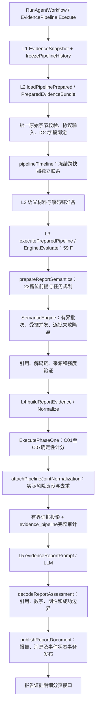

# 五层流水线及实际入口

`prepareReportInputMode` 委托统一入口；不保留另一条默认正式计算路径。显式 `LegacyReportEvidence` 兼容选项供旧调用和回归使用。独立的只读验收使用同一入口的 `Persist=false`：不调用模型、不写缓存。

## 各层复用关系

| 层 | 原实现与新增组织 | 标准结构 |
|---|---|---|
| L1 | EvidenceSnapshot、历史查询、freezePipelineHistory、snapshotBoundedPage | EvidenceSnapshot、ReportHistory.FrozenSnapshots、来源版本/H/R |
| L2 | loadPipelinePrepared、原协议适配器、共享解析、独立时间线与语义材料准备 | PreparedEvidenceBundle / EvidencePreparedInputs；复用Request/Input、PhaseOneMaterials |
| L3 | 原 Engine、原语义前提/规划/校验器；新增批次并发与panic隔离 | Result、SemanticPlan、SemanticResult、BatchMetric |
| L4 | 原 Normalize/EvaluatePhaseOne；新增统一终态、C贡献与投影 | NormalizedEvidence、PhaseOneResult、EvidencePipelineAudit |
| L5 | 原正式报告业务；增加实际投影引用及数字边界校验 | ReportAssessment、ReportDocument、结构化 evidence_risk |

## 不变量

- IOC可信度、审核、有效期由上游负责；本地继续核验实际字节中的类型、值、字段位置和资产/端点关系。
- 历史来源在F执行前固定各自版本、水位和修订水位。逻辑快照不宣称跨表SQL事务快照；资产与外部注册表以内容摘要冻结。
- 原始命中数量、TCP分组数量不会被替换成通信次数。独立TCP联系、DNS请求和HTTP事务按资产/端点/IOC及观测类型分开；C02与C03覆盖门槛独立。
- 59F和23S目录终态统计为82；scope/task实例可以多于82。C是独立联合层，不计入82目录数。
- F/S自身加分始终为零。归一化joint记录只承接C实际贡献，封顶后贡献合计等于结构化策略分；模型字段不能修改后端分数。
- `observed`、`not_observed`、`missing`、`not_applicable`、`execution_error`、`skipped` 分开；中立保留已执行状态及未决结果，不变成阴性。
- 正文和模型使用完整实例组成的有界投影；省略实例仍在审计中，省略数量明确。校验只接受实际投影中的证据ID。

## 缓存和审计

| 记录 | 依赖与用途 |
|---|---|
| evidence_preprocess | 模型和报告提示词无关；数据版本、注册表、预处理及执行输入控制；保留HTTP原始请求等私有暂存字段 |
| evidence_result | F算法版本、数据身份、参数及来源；完整独立观测F结果另存对应键 |
| evidence_timeline | 当前与各历史来源身份、独立时间线及预算；暂态不完整结果不冒充完整缓存 |
| semantic_result / semantic_model_input | 模型版本、实际计划、材料摘要、语义版本、预算和并发配置 |
| phase_one_result | 可信F/S输入、C版本和策略；变更策略不要求重新解析原始包 |
| evidence_pipeline | 压缩分块审计清单，最后提交manifest；逐块摘要校验后展开来源集合引用 |
| report_document | 实际投影、确定性C结果、最终研判及审计键；正文与附录回读验证 |

审计保留全部归一化实例、字段来源ID、窗口、限制和C结果。重复来源集合内部字典化，读取时还原；不重复嵌入多份F结果和完整请求正文。原始材料仍由冻结快照与语义日志的来源引用绑定。

明细接口：`GET /api/events/detail/{event_id}/report/evidence?summary_id=<ID>&offset=0&limit=50`，沿用报告登录鉴权及固定summary绑定；limit为1至100。返回82项目录审计及分页归一化实例，不接受任意外部审计键。

## 预算与边界

`Services.EvidenceLimits` 提供部署侧注入配置：页行数/字节、行字节、当前快照字节、保留特征字节、历史字节/命中/快照数及总/当前/历史超时。零值使用有界默认值：每页至多500行、2MiB；当前及历史分别512MiB；保留特征32MiB；历史100快照/20000条；总5分钟、当前60秒、历史30秒。

保留特征预算不是进程RSS硬限额。压缩审计16MiB、展开线性JSON256MiB、每块512KiB；超预算明确失败，不能发布缺失完整审计的报告。预处理缓存8MiB压缩/64MiB展开；超过只跳过该缓存，不伪造读取完成。

S默认串行批次，可配置至多4个并发批次。输入按字节有界、输出Token及超时有界；`MaxInputTokens` 需注入真实 `CountTokens`，缺失时明确配置错误。当前无目标模型分词器，不能将字节估计冒充实际Token使用或已验证的模型容量。
