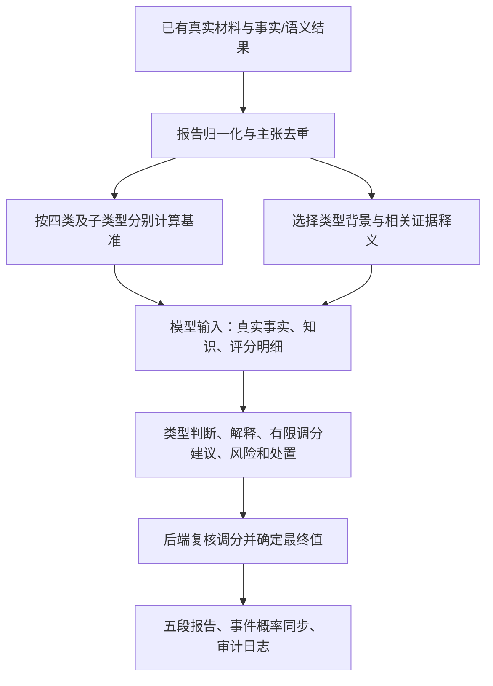

# 研判层改造任务书

版本：v1.2；日期：2026-10-22；状态：设计交付，尚未实施。

## 一、目标与交付边界

让报告的数值有稳定、可追溯的计算基础，让模型理解威胁与证据的意义，让报告以简洁事实和关联逻辑支撑结论。相近材料不得仅因模型措辞变化出现40与70这样的任意跨度。

本次交付仅为任务书和四份知识卡，不代表评分、加载器或报告模板已经上线，不提交、推送或部署代码。

后续实施限定于证据归一化之后的报告专用研判路径：评分、知识选择、模型输入、有限调分、报告组织及日志。不得修改采集端、数据库结构/索引、告警检测/聚合/审核、其他模块、全局模型配置或前端。保持事实算法和语义槽位的现有执行条件；发现上游缺项记录依赖，不以本次任务放宽或改写算法。共享方法必须通过报告专用路径或显式参数隔离。

## 二、现状与需要改变的行为

现有 `DefaultPhaseOneConfig()` 的C01—C07是一期策略分；`reportWeightPolicy()`主要输出相对影响提示；最终概率由模型生成。三者尚未建立确定性计算关系。旧策略分10不能直接解释模型62%。

目标为：后端计算基准值；模型看到公式摘要、本次贡献明细、相关专业知识及真实证据；模型解释当前活动并提出受限调整；后端采纳合格调整、形成最终值并统一入库。普通聊天追问继续原路径，正式生成/重新生成报告及自动报告共用本次路径。



## 三、知识文件组织：KD只放四份

| 文件 | 类型 | 内容 |
|---|---|---|
| `KD/Botnet.md` | 僵尸网络/群体协同 | 背景、简明公式与权重、组合关系、群体证据意义 |
| `KD/C2.md` | 命令与控制 | 背景、简明公式与权重、组合关系、控制证据意义 |
| `KD/NetworkActivity.md` | 网络活动 | 扫描/外传/利用/挖矿/一般接触分开评分及对应证据意义 |
| `KD/Phishing.md` | 钓鱼 | 背景、简明公式与权重、组合关系、欺骗与敏感操作证据意义 |

不在KD新增README、算法输入清单、逐实例审计、原始数据或运行日志。执行细节放本任务书与实现代码；模型知识保留总体专业特征（典型行为链、核心识别特征、有效组合、合法相似行为和判断边界）、每条证据的意义及支持方向，不复制算法阈值、数据库字段、报文解析和调试细节。

四份文档按主归属共覆盖当前代码目录中的59条事实定义和23个完整语义槽位键。跨类型通用知识可以复用，不意味着每次输入全部82条。运行时F002/S003等编号可能变化，知识映射必须按 `fact_id` 或 `(slot_id,target,subtype)` 完整键进行，不能按报告序号或中文名称猜测。

### 3.1 必须对应当前实现，不能新造抽象证据目录

| 实际类别 | 定位方式 | 本任务的使用方式 |
|---|---|---|
| F | `ReportEvidence.FactID`，如`F_BEACON_PERIODIC` | 直接按四卡所列稳定规则ID计分；规则是否命中沿用上游 |
| S | `SemanticFinding.Slot`完整`ID/Target/Subtype` | 内容型语义按实际键计分；解释型只解释原事实，不重复加分 |
| I | `ReportEvidence.Kind=intelligence`且`Feature=ioc_background` | 按实际情报对象和来源贡献，不把情报条数当独立行为数 |
| O | `ReportEvidence.Kind=observation`及`Feature` | 概览/核查为主；仅四卡显式列明的观测允许辅助计分 |

四卡权重表逐行写具体F/S/I/O键，不再用“情报族、时间行为族、协议族”等名称代替实现映射。同行上限仅是计算约束，不创建新的算法、证据类型或目录。后端现有`Family`可辅助识别同源，但不能据此给未映射项自动加分。

F002、S003、I001、O001均是本次报告实例编号；评分按稳定实现键定位后，映射回本次ID供模型引用。不得把F002写死为某一事实规则，也不能把O003固定为某种统计。

O实际实现包括`report_material.go`的`saved_activity`、`application_fields`、`dns_connection`，`report_schedule.go`的`schedule`，`report_practical.go`的`time_distribution`及其他已输出feature。O不是新增加的F算法目录；普通端口、零载荷和记录数不能因为已有O编号就自动加分。

## 四、评分执行契约

### 4.1 分值含义

固定判断命题为本次活动的恶意倾向，不是失陷概率或攻击成功概率。四卡的权重和基线是启发式初始参数，不能声称来自历史训练或已校准。对外保留现有概率字段以兼容业务，报告写“研判恶意倾向：X%”，不得写“准确率X%”或“失陷概率X%”。方法属性统一放附录或说明，不在每条证据后重复免责声明。

没有任何有效支持或反向依据时，不得把公式基线包装成有效研判；走现有材料不足处理，不制造成功报告。0～100映射不是概率准确性的证明。

### 4.2 基础公式及计算顺序

对每个候选类型t分别计算：

```text
x_i = strength_i × reliability_i × binding_i
c_i = weight(t, actual_implementation_key_i) × x_i
G_r = min(row_cap_r, max(c_i) + 0.35 × Σ同行其余独立c_i)
H_k = combination_weight_k × min(组合成员x_i) × verified_relation_k
z_t = -2.2 + ΣG_r + ΣH_k - Σcounter_contribution
raw_t = 100 / (1 + exp(-z_t))
base_t = min(raw_t, evidence_cap_t)
final_t = round_half_up(clamp(base_t + accepted_delta_t, 0, evidence_cap_t))
```

先去重，再按实际实现项及权重表同行上限计算贡献，再计算组合，再反证，再映射、封顶、调分，最后一次四舍五入。所有排序稳定，浮点中间值不提前取整，日志保留未取整值。不能按当前“有材料项数量”重新分配权重或归一分母，否则缺材料越多反而越容易高分。

参数以四卡的权重表为准；凡未明确赋权的条目默认0并说明是背景、解释或待映射，不能自动补正权重。`F_IOC_TYPE_CORROB`是评分后的一致性解释，禁止回流加分形成循环。原report-weights-1.4的1.15/1.25不再作为额外乘数叠加到新公式。

### 4.3 三个因子由后端决定

| 因子 | 初始取值规则 |
|---|---|
| strength | 上游合格命中事实=1；内容型语义strong=1、medium=0.6、weak=0.25；未命中/未执行/拒绝=0。解释型语义不另计，使用其对应原事实主张。不得由报告模型重新声明命中。 |
| reliability | 对计分主张所需的关键测量与关联已核验=1；有来源、上游明确允许partial阳性且关键主张成立=0.7；关键测量或来源不成立=0。部分材料缺失不否定已经测得的阳性，不能因缺少整个会话就抹去实际报文事实。 |
| binding | 与本次资产、对象及适用窗口精确绑定=1；情报仅为本次真实访问的共享IP关联、未精确到实际域名/请求对象=0.4；只有同资产背景或无法绑定当前对象=0，仅作背景。IP不能因为不是域名就一律降权，只有已证明是共享IP且归属精度不足才用0.4。 |

如果上游没有这些标志，评分适配器应依据已有核验信息给出明确、可复验的映射；没有映射不得让LLM填写。逐项记录使用的字段、规则和来源。不能以“有JSON”视为可靠，也不能为强行得分改写上游核验状态。

默认非工作时段单项权重0.25，若只是默认08:00—20:00比较而无实际作息，strength最多0.5；已配置的资产作息优先。默认时段仍可贡献弱线索，不增加必须提供角色或作息的硬门槛。已证实全天运行且本次行为属于该业务时，该时段主张不产生正向贡献。

### 4.4 去重与独立性

主张键至少包含：类型、实际规则/槽位/观测键、资产/群体、端点、适用窗口、源材料集合及所证明的行为。相同事实的多个规则、语义解释、重复情报或跨日统计拆分取最强贡献。不同记录数不自动代表独立。

- 历史事件总数与有效通信样本数保留各自口径，但同一复发行为不重复加分。
- 非工作时段统计与作息语义解释只形成一个主张。
- 小载荷与零载荷不能拆为两份恶意依据；443、普通ACK、记录数量本身权重0。
- 同域名情报转引只算一个来源；独立情报主要提升同一情报主张可靠度，不伪装成独立行为。
- 单一语义槽位输出、命令载荷、其解码结果如果来自同一内容，不是三份独立证据。
- 真正不同事务或时间窗口提供新主张时可以按35%折减贡献，但仍受同行合计上限约束，不能按报文条数累加。

### 4.5 组合增强

组合必须来自四卡白名单，明确成员主张、实际关系、适用类型。`verified_relation`只取0或1，不能让模型凭叙述关联。要求同事务的必须有事务链；群体组合必须核验成员及同一实际基础设施；仅同资产或时间接近不能建立战役关系。

组合奖励的是“两个事实之间的新关系”，成员单项分可保留；但同一批材料换名不构成组合。共享成员的组合构成冲突集合，按实际贡献从大到小、规则ID字典序决胜，已占用成员的组合不再计分；总组合贡献上限1.5。模型不能临时发明额外组合。

### 4.6 反证和证据上限

四卡共同约定：已核验本次任务授权/基础服务匹配的反证，权重1.2，同任务合并，反证总上限2.0。抵扣范围限定到该任务覆盖的主张及组合，不得抵扣另一对象/事务的恶意内容；扣减量不得超过所覆盖正向贡献。仅平台身份、未审核、缺少恶意正文、尚未发现后果不构成反证。

证据上限由后端判定，四卡分别写明类型行为与直接恶意门槛：

- 只有情报、普通接触或一般历史关联，无类型行为，最高59。
- 有类型相关行为，但没有直接恶意证据与独立佐证，最高79。
- 直接恶意证据与独立行为相互印证，最高94；不承诺一定达到80。

强语义要符合现有上游核验标准。高分中的独立佐证须另有源材料或独立测量主张；同一请求的两种语义复述不算。材料不足不是反证，未满足高分门槛只是不能进入高分档。

当前没有独立的“未授权挖矿”实现项，不设置虚构的未授权组合或默认正向贡献；S11可支持挖矿活动，不能独自证明其恶意性。

### 4.7 类型选择与模型弹性

四类分别形成结果；NetworkActivity内部再分别计算扫描、外传、利用、挖矿、一般接触，不跨子类型叠加。仅算术最高且没有类型门槛的类型不能获选。默认选择有类型行为支撑的最高项，平分依稳定类型键排序；全部无类型行为则回退一般接触。其他类型结果留日志，不将四类相加或平均。

模型可提出从候选集选择另一类型，但必须引用该类型实际特征；后端核验并使用该类型已有计算结果，禁止把高C2分直接改名为钓鱼概率。与旧 `threat_type` 的映射要明确，旧风险/告警等级不因此被修改。

模型调整最多±5个百分点，只能依据评分规则未覆盖的“已观测事实关系或明确业务上下文”；仅觉得可疑、不足、经验上应该高、重复列举已计分事实都不合格。调整须提供 `delta`、`reason`、`evidence_ids`、`uncovered_context_key`；后端校验引用、范围、未重复计分，无法确认时采用0并记录原因。相同事实与上下文生成的最终结果跨度最多10个百分点，不能从40跳70。原始建议与实际采纳值都留存。

## 五、模型可见知识和输入

后端从四份知识卡选择候选类型的总体专业特征及与当前证据对应的意义行，附必要的组合解释和已成立反证；通用规则只注入一次。禁止每次全量输入四份全文，也禁止让模型自行检索不存在的材料。模型可读的是精简专业知识，不是算法实现课程。

正式输入包含：

1. 当前事件概览：时间、方向明确的五元组、记录数量和范围、实际请求对象、情报来源。
2. 归一后的有效事实：实际测量、适用窗口、关系边、必要来源引用及已证实反证。
3. 威胁背景、相关证据意义、公式摘要、权重、已触发组合和去重结果。
4. 各候选类型的基准结果、上限、逐项贡献；明确模型调整权限。
5. 五段报告结构、事实边界及JSON输出约定。

不得将上游目录注册状态当作实际命中。缺材料、未执行明细及长来源ID列表留审计日志；影响结论的可见范围简要保留。保留足以定位事实的短引用，不能彻底抹掉来源关系。

预算使用现有报告专用输入、输出参数及实际模型上下文限制，不引入全局配置变更。总预算包括system、user、调整/修正提示和预留输出。先去重复措辞和无关知识，后压缩背景；不能静默删核心事实、关键测量、窗口、关联边或已证实反证。确实无法容纳时记录budget_exceeded并沿用现有失败/保留旧报告机制，不伪造成功。不得新增无授权的多轮语义调用以绕开预算。

## 六、报告内容与微调

只生成五部分：研判结论、事件总览、关键证据、风险分析、处置建议。

- 结论：先说明本次判断与最终恶意倾向，再用两三句说明核心行为与关联。模板中的数值由后端插入，模型不能在正文另写一个概率。
- 总览：明确谁、何时、对谁、什么协议、多少已保存记录。区分资产与远端、连接与DNS解析器、当前与历史；不得把DNS解析器写成攻击源。
- 关键证据：一项一两句，格式“编号＋事实＋意义”。按对判断贡献及关联顺序组织，不按算法执行顺序；重复主张可合并列多个引用，但保留各统计口径。
- 风险：围绕已支持的类型解释受保护对象与后果，尚未发生的后果用条件句，不编造攻击链或宣称已失陷。
- 建议：面向被攻击方/资产责任方，写明查什么日志、进程或配置，及什么事实出现时采取隔离/阻断，不能只写补材料。

正文删除逐类成立/缺失计数、算法变量、审计键、重复替代解释和方法声明；移至日志或附录。“默认非工作时段”保留事实限定，不能改为已确认作息异常。未经证实的猜测不写，不通过删除“可能”把它变成肯定句。影响处置的缺项改成具体核查动作。不得手工修改最终报告文本来代替系统修复。

示例：

> F006：有效历史通信样本覆盖20个自然日，说明该资产与目标存在跨日重复接触，应核查对应进程及业务任务。

反例：

> F007零载荷符合探测型接触，C01成立1、C02材料不足1，详见审计键……

模型负责结论依据、风险和处置的自然语言组织，不要求确定性算法单独判定未观测的攻击意图。格式检查负责必要字段和引用；评分调整不合格只回退0，不额外把整篇报告判失败。不新增文风、关键词或每个数字的过度严格失败门槛；保留现有必要约束的改动须单列说明和真实回归。

## 七、代码实施清单

以下为待实施修改，不是本轮已完成的代码：

| 文件/位置 | 方法或新增组件 | 改造内容 |
|---|---|---|
| `traffic/internal/service/report_scoring.go`（新增） | `scoreReportThreats()`及专用结果结构 | 基线、因子映射、同源去重、组合、反证、上限、子类型及最终值；纯计算，可脱离LLM测试 |
| `traffic/internal/service/report_knowledge.go`（新增） | `selectReportKnowledge()` | 按稳定ID选择KD释义、去重通用知识、版本校验、报告预算选择 |
| 报告专用构建资源 | KD四文件嵌入/显式复制加载 | 发布时携带同commit的知识；不读取开发机绝对路径，不擅自改变全局配置 |
| `report_weights.go` | `reportWeightPolicy()` | 正式报告返回新确定性策略；旧调用方保留行为，不能再叠加旧相对系数 |
| `report_essence.go` | `buildReportEssence()`、`essenceWeightPolicy()` | 保留事实测量与口径，建立主张及去重关系，评分与模型投影使用同一证据集合 |
| `report_assessment.go` | `evidenceReportPromptBudget()`、`ReportAssessment`、`decodeReportAssessment()` | 注入精简知识和本次计算，返回类型、调分建议、解释、风险及处置；最终数值由后端确定 |
| `report_pipeline_validation.go` | `validatePipelineAssessment()`及调整校验 | 明确合法类型/引用，非法调分回退0，不让模型覆盖后端基准或绕过证据上限 |
| `report_narrative.go`、`report_assessment.go` | `renderNarrativeReportMarkdown()`及现有渲染入口 | 五段正文，关键事实与自然语言意义，移除执行计数/审计键等干扰内容 |
| `agents.go`及现有正式报告入口 | 正式报告生成与发布方法 | 自动/手动/聊天正式报告共用评分和最终概率，事件列表同步相同值，失败保留旧成功报告 |
| 现有repLogs写入器 | 报告专用日志扩展 | 同一次运行保存评分、知识、输入、调整和发布结果，避免重复全量UUID |

资源路径以仓库 `vulnscan-backend/traffic/internal/service/` 为上表前缀。实施前核对当前函数和调用链、现有未提交改动及生产版本；函数名漂移时更新映射，不能仅照文件名机械修改。

旧C01—C07可留审计及兼容结果，不与新模型双重加分，也不继续占据正文关键证据。新旧评分明确版本区分，禁止改写历史已发布报告的数值。

## 八、日志与可复验性

沿用 `data/repLogs/<日期>/<事件>/<运行>/`，至少保存：

- `threat-scoring.json`：版本、类型、有效强度因子与来源、单项和实现项贡献、去重、组合、反证、上限、原始及基准结果。
- `knowledge-selection.json`：四卡版本及文件、实际选用的类型/证据键、被省略知识及预算原因。
- 实际LLM请求和响应：复用现有请求日志，记录真实输入输出限制，不另造一份与实际调用不符的“示意输入”。
- `model-adjustment.json`：原建议、引用、采纳/拒绝原因、实际delta、最终类型与数值。
- 发布结果：事件、报告ID、快照、知识版本、评分版本、部署commit、最终入库数值。

日志短引用可定位完整来源；大UUID列表只在原审计明细保留，不在各阶段反复复制。没有数据库/schema变更，不新建全局审计平台。

## 九、实施顺序与验收

1. 核对四卡与59事实/23完整槽位键，建立全部条目的“计分/仅解释/背景/条件反证”映射；未知键不猜测。
2. 实现纯评分与归一去重，输出本次贡献明细，确认材料不足不加分也不当反证。
3. 实现精简知识选择和发布资源携带，输入日志与实际请求一致。
4. 接入受限调分及后端最终值，统一三个正式报告入口，保持普通聊天原行为。
5. 改造报告五段表达和日志，处理旧策略兼容。
6. 在隔离源码验证必要测试，再使用真实事件生成报告检查事实、逻辑和概率同步。代码提交、推送和部署需后续用户明确要求；本任务书交付不启动实施或独立评审agent。

必要验证清单：

- 相同证据与参数计算同一基准；改变排列、重复报文、重复语义或情报转引不抬分。
- 新增有效独立正向证据，在其他条件不变时基准不降低；新增成立组合产生可追溯增量。任务授权反证只抵扣覆盖行为。
- 缺材料不被当负证据；可评分项变少不会因分母变化抬分。
- 普通443、ACK/零载荷、只有历史或情报不能进入80～90。
- 四类及NetworkActivity各子类型至少有算例；真实强证据满足条件时允许进入80～90，无真实强案例则明确记录，不合成高分业务成果。
- 模型±5、超限、无引用、重复计分、错误类型、共享源及不合格上下文均有边界测试；最终值写入报告和事件列表一致。
- 实际模型预算内保留核心事实、指标、窗口、关系及已证实反证；检查选用知识不是整库全文。
- 真实相近事件对比，解释任何明显分差来自哪一项材料或计算变化；生成结果不再仅凭模型自由漂移。
- 正文没有C01—C07执行计数、审计键、变量堆砌和无材料的攻击剧情；概率不出现两个口径，DNS角色不混淆。
- 既有报告相关测试通过，其他失败与修改前基线比较；不把启动成功或合成算例替代真实报告验证。

本轮完成标准：KD中恰好四份简洁知识/评分卡，59事实和23槽位有明确释义归属；任务书明确三部分、业务边界、公式、组合去重、模型权限、实现位置、日志与验收。部署和真实报告效果不属于本轮已完成事项。
