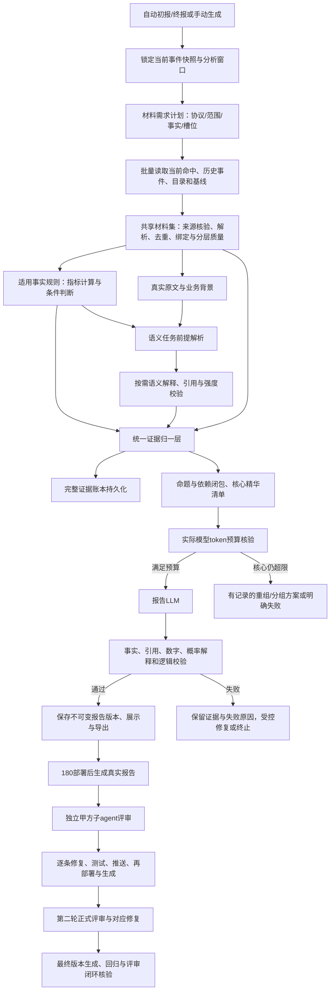

# 证据库数据闭环与研判报告改造任务书

版本：任务书 v1.3　日期：2026-10-12　范围：仅研判报告生成逻辑及其专用证据处理链路。

本版在v1.0完整数据契约上增加：真实证据权重调节、180部署后生成报告、独立甲方视角子agent评审，以及至少两轮评审—修复—再生成闭环。v1.0保留作历史版本，后续实施以本版为准。

v1.2补充正文要求：突出确定事实、证据支持的结论与具体处置建议；未证实判断不写进正文，通用缺口和失败详情保存在技术附录。模型输入仍保留影响判断的完整依据，不能通过隐藏反证或缺项制造确定性。

v1.3增加强制范围约束：本期只修改报告生成逻辑，其他平台行为保持现状。本文所有实施任务、数据需求及评审意见均受第1.1节约束；数据需求清单不构成改造采集端、数据库或其他模块的授权。

**本轮交付仅为任务书。本文要求的代码实施、测试、GitHub 提交推送与 180 服务器部署，属于后续执行阶段，本轮不执行。**

## 1. 业务目标与完成定义

证据库要解决的是：报告可以说清楚“实际发生了什么、为什么作出这个判断、哪些证据影响概率、哪些事实尚未证实”，读者能够沿引用核查，模型不能只复述 IOC 标签或凭一条代表报文泛泛猜测。

业务链路固定为：**收集真实材料 → 算法发现事实与语义解释 → 证据归一化 → 有依据的权重与概率解释 → 保留研判精华的LLM输入 → 生成并校验报告 → 部署到180生成真实报告 → 独立甲方评审 → 修复并重新部署/生成 → 再评审与验收。**

本任务保留最初设计的 59 种事实规则和 23 个语义槽位，逐项落实数据供应与执行契约。目录数量是能力范围，不是每条事件必须产生 82 条阳性证据。不同协议、范围和观测条件下，适用规则不同。同一规则在多个资产或端点可以产生多个实例。

完成不能只以“代码已写”“可以返回 JSON”或“目录中登记了 82 项”为依据，必须同时满足：

1. 每种规则/槽位具有明确的必需字段、真实来源、适用条件、参数和质量要求，能够追到生产者与读取位置。
2. 当前平台能够提供的材料必须实际供给；无法提供的材料必须说明具体原因和补齐路径，不能用整体 `missing_input` 掩盖。
3. 数据充分的适用规则正常计算；结果不成立也是有效完成。缺输入、缺参数、未调用和调用失败分别记录。
4. 所有影响当前结论的核心证据、反证、关联条件与判断边界进入最终模型输入；上下文受限时不得悄悄丢弃。
5. 报告中的关键事实、数字、类型判断和概率解释均可追溯到本次送达证据；没有证据支持的成功性判断不得输出。
6. 自动初报、自动终报、手动生成/刷新以及页面展示、导出使用同一证据与报告契约。旧报告和新版本报告可区分，生成失败不能显示旧报告并伪装成成功。
7. 在180新版本上实际生成报告，由不同于实施者的独立子agent模拟甲方公安研判人员评审；至少完成两轮正式质量评审与对应意见修复，保留逐条闭环记录。
8. 强且独立的真实证据组合应能支持80～90的威胁概率；该区间是证据充分案例的目标，不是样本配额、硬下限或验收造数要求。证据不足时不得人为拉高。

### 1.1 强制改动范围与隔离要求

**本期唯一改造对象是“生成研判报告”的内部逻辑。** 自动初报、自动终报、手动生成/刷新继续使用原有入口和触发方式，仅改造其生成报告时的数据使用、证据分析、模型输入、结论和输出内容。

| 范围 | 本期允许的工作 | 边界 |
|---|---|---|
| 报告专用材料读取 | 从现有命中、历史事件、资产、目录和可用文件中读取材料；有界只读查询、批量读取和报告缓存 | 不改原始数据，不改变通用存储行为，不新增表、字段、索引或迁移 |
| 报告专用证据处理 | 解析已有材料、基础指标、质量分层、去重、历史关联、事实与语义执行、归一及核心摘要 | 不改变在线告警检测、聚合、匹配、分组或其他调用方的算法行为 |
| 报告模型调用 | 报告/报告语义专用提示词、上下文预算、引用与输出校验、错误处理 | 不改其他业务的模型配置或通用客户端默认行为；必要参数在报告调用中显式传入 |
| 报告权重 | 调整报告生成使用的证据影响策略和报告中的概率依据 | 不改平台告警分数、风险等级、IOC评分、其他模块权重或历史已保存结论 |
| 报告内容与追溯 | 在现有报告载体中生成证据表、时间线、明确结论和追溯内容，沿用既有保存/导出链路 | 不改其他页面、通用样式、路由或API契约；前端改造不纳入本期 |
| 测试与发布 | 报告相关测试、真实生成、独立评审及目标改动提交/部署 | 不夹带已有无关未提交改动，不借部署修改其他服务、全局配置或基础设施 |

以下事项本期不实施：采集节点及其snaplen/PCAP保存配置、原始命中生产与入库协议、数据库结构与通用索引、正常流量采集/基线训练系统、新建品牌/服务/资产/授权资料管理系统、告警检测/聚合/状态流转/审核、资产与情报管理、其他报告或业务模块、通用LLM默认配置及前端功能/排版工程。

已有数据能够推导的字段，在报告专用适配器中核验产生并保留来源，不回写原始记录。现有数据不能提供的字段，登记为范围外依赖，正文只输出已有证据支持的事实；不能为达到82项完成数、概率目标或关闭评审意见而扩大修改范围。

共享代码的修改必须先证明调用范围：优先使用报告专用适配器、包装方法或显式参数。若会改变其他调用方，则本期不修改该共享默认逻辑；记录所需改动为后续任务。文件位于evidence目录不等于天然属于报告专用，必须以调用关系核实。

实施前建立改动文件清单及用途；实施后逐项检查diff、调用关系、配置和数据副作用。报告入口签名、触发时机和其他模块行为保持兼容。部署采用目标提交构建产物，不把工作区中与本任务无关的代码一并发布。

本节优先于本文后续关于“补齐材料”“生产策略”“采集质量”“数据库压力”“页面导出”及其他广义描述。独立甲方评审可以提出范围外建议，但不能将其自动转成当前实施任务；不能在不满足依据的情况下强行关闭对应实质问题。

## 2. 设计依据与当前问题

原始设计依据为桌面“流量研判方案/证据库v0.1”中的五个核心证据库、`证据目录.json`、`evidence/catalog.details.json`、语义注册表及统一契约。实现核对依据为后端 `evidence` 与 `traffic/internal/service` 的规则、输入适配、语义执行和报告代码。本文附录逐项保留原设计字段，并补全执行所需的字段、参数及绑定条件。

历史文档中的 PoC 范围、旧版 enabled 标记和“需裁决后才可参考历史”等说明不能代替当前需求：**所有匹配历史都参与关联分析，不以审核通过/驳回为检索前提；历史报告里的模型结论不能当作已证实事实反复输入。**

2026-10-10 对 7 条真实事件、141 条命中材料的检查发现：快照成员能够读取，但普遍缺少 `capture_truncated`；存在 6 条实际帧长度不足 IP 声明长度的记录；生产缺少多项策略参数；外部基线、目录及历史材料供应不足；已有端口和 DNS 等事实未充分进入报告；语义预算与报告输出校验也有失败。

此前“修复两个输入问题后 1→3 种事实规则、2 种语义槽位输入满足”的结果仅适用于该批固定快照与现有参数，不是平台能力上限，也不能成为删减原设计的依据。本任务要解决全链路问题，不以两个局部修复作为项目完成标准。

## 3. 完整业务流程与模块职责

### 3.1 证据收集层

职责是满足证据模块的数据需求，负责查询历史与读取平台材料，不要求报告模型自行找证据。一次生成建立共享材料快照，事实算法和语义适配器复用，不让 59 条规则分别访问数据库。

流程先做协议与可见性判断，再生成材料需求的并集。协议无关的基础事实始终保留；不适用的规则记录理由。计划不得因为想节省计算就跳过已适用、材料充分且影响结论的规则。

原始报文、平台元数据、外部目录、正常基线和历史记录分别保留来源属性。传输字段完整、应用消息完整、会话完整和整个时间窗口覆盖是不同概念，不能用一个布尔值互相代替。

### 3.2 事实规则与语义槽位

事实规则输出可重算的指标、条件、状态和引用。基线缺失时，仍输出不依赖基线的当前观测指标，把“指标已计算”与“异常性不能判定”分别表示。不得为了提高完成数量降低统计前提或补造正常基线。

语义槽位解释需要理解的实际内容：命令意图、页面欺骗、敏感上传、请求应答意义、业务替代解释和历史模式等。先核验字段、事务、解码链、事实前提及材料范围，再调用模型。语义解释不修改原算法指标，不以解释强度充当概率，不把同一原文解释当作独立第二份证据。

语义槽位的“输入满足”“已发送”“模型成功返回”“引用校验通过”必须分别可观测。不能把前提满足数量报成成功完成数量。

### 3.3 归一层与报告层

归一层独立于数据库和模型，负责统一身份、状态、指标、引用、证据角色、依赖与重复关系。全量结果保存在证据账本，模型输入是其受约束投影。

报告模型负责把证据组织为可读的研判逻辑。程序负责事实表和可追溯引用，模型不能自行编造表格数据、来源或计算值。报告生成成功以完整输出和程序校验通过为准。

## 4. 通用数据契约与材料供应

### 4.1 每条材料必备的公共字段

| 类别 | 必需内容 | 要求 |
|---|---|---|
| 身份 | event_id、snapshot_version、hit_id/source_id、source_type、source_version | 当前快照、历史和外部目录可区分；重复来源不重复计证 |
| 范围 | asset_id、device_id、endpoint_id；群体另带 group_id/member_ids | endpoint 包含协议、地址/域名及端口；资产归属不能从 IOC 标签猜 |
| 时间 | occurred_at、analysis_start/end、timezone、as_of | 时间戳统一精度；保存时区；历史不得晚于当前分析时点 |
| 定位 | field_path、记录主键/文件定位、必要字符/字节范围、内容hash | hash用于追溯，不等于真实性证明 |
| 采集质量 | captured_length、wire_length、截断状态及原因、缺包/丢包/分片/重组状态 | 未知保留 unknown；IP长度核验只证明当前保存帧，不证明完整会话 |
| 覆盖质量 | 查询范围、页数、读取数、绑定数、去重数、是否达到上限、窗口是否完整 | 告警命中集完整不等于全部网络连接完整 |
| 可见性 | 实际协议、明文/密文、可解析字段、完整消息/片段 | SNI不是HTTP Host，TLS记录头不能证明协商版本，ACK不是业务应答 |
| 关联 | session_id、transaction_id、request/response对应、DNS问答、成员归属 | 绑定由程序核验，不能接受模型或原文自报的verified |

### 4.2 数据来源与具体补齐要求

| 材料集 | 真实来源/取得方式 | 必须提供的精度与约束 |
|---|---|---|
| 当前命中及五元组 | 当前快照关联的数据库命中记录与版本 | 全量遍历固定成员；方向、端口、TCP标志、长度、时间、规则命中分开提取 |
| 原始报文与PCAP | 采集节点已保存文件与原始packet字段 | 在报告适配中核验一致性并记录长度矛盾；不改采集配置或原始文件，缺失字节不能凭空恢复 |
| DNS | UDP完整消息或TCP重组消息、解析器/网关日志 | 问题名、类型、transaction id、QR/TC/rcode、回答IP、TTL与客户端；问题域名和情报描述域名不混同 |
| HTTP/页面/表单 | 已有明文请求应答、代理/网关日志或可用事务保存 | URL、Host、方法、UA、字段、响应、页面/表单目的；TLS密文不能直接转成明文 |
| TLS | 可见且重组核验的握手、可用网关日志 | SNI、实际协商字段、证书DER/链、指纹所需握手元素；TLS1.3等不可见证书明确不可观察 |
| 会话计数 | 可信会话聚合、exchange及可验证重组 | 会话起止、双向字节/包数、状态、计数语义与重置规则；累计计数不可逐命中相加 |
| 正常基线 | 覆盖正常流量的历史数据及版本化训练产物 | 样本范围、分母、窗口、分位数/频率、训练版本与有效期；告警库不能冒充正常流量库 |
| 资产与群体 | 资产登记、业务角色、NAT/代理映射、成员证明 | IP资产、业务角色与真实设备身份分开；公网NAT地址不等于一个或多个已证实成员 |
| 品牌/服务/基础设施/TLS目录 | 已有平台目录或新登记的外部真实资料 | 字段、更新时间、提供者、授权关系及覆盖范围；常见端口不能代替真实服务目录 |
| 授权任务/演练/作息 | 实际工单、扫描/演练登记、业务登记 | 主体、目标、端口、协议、时间、角色、作息；名称或备注不等于授权证明 |
| 情报与规则来源 | IOC记录及提供方原始来源链、规则注册 | IOC实际匹配字段、类型、来源链、独立组、时间；转载源不能算独立源 |
| 历史活动 | 平台事件库及关联命中记录，由证据模块自动检索 | 全部匹配历史，不按审核状态筛选；事件时间、资产、IOC、端点、规则族和实际观测有引用 |
| 阶段/战役/协同证明 | 当前与历史活动的独立关系记录、已核验事实链 | CurrentStage、CampaignID、成员全集、相同基础设施与协同参数必须真实绑定 |
| 解码/分块/内容分类 | 程序解析原文、验证解码与传输join，取得分类依据 | 逐步输入输出、事务、块序号、大小、请求应答关系，不能跨无关请求拼接 |

每个材料供应项登记：生产组件 → 原始字段 → 保存表/文件 → 查询入口 → 适配字段 → 使用规则/槽位 → 缺口代码 → 补齐负责人/实施任务。空来源必须明确，不能写“后续完善”而无具体路径。

### 4.3 历史关联专项

1. 按当前事件真实资产、类型化IOC、端点及分析时点建立查询；同资产或同IOC的候选分别返回，不要求两者同时匹配才检索。
2. 排除当前事件、未来记录、非法时间与重复记录；审核状态只是历史属性，不是过滤条件。
3. 明确标记关系：同资产、同IOC、两者相同、同端点、DNS回答IP后续连接等。仅“同资产”不能提升成“同战役”。
4. 补读必要历史命中，核验协议、端口、DNS回答、设备归属及时间；对DNS回答IP与后续连接关联计算间隔，保留双方来源。
5. 群体复发和协同参数匹配必须核验完整成员集合、基础设施和需要的战役绑定；阶段递进必须包含当前阶段并核验同IOC或同活动链。
6. 使用历史原始事实与可核验属性。历史LLM描述可以标注为历史解释，但不能递归升级为事实或独立恶意依据。
7. 查询上限、超时或不完整时保留已匹配活动；没有匹配只能说“在完整检索的声明范围内未找到”，不能说“从未发生”。

### 4.4 数据库压力控制

当前命中分页批量读取；历史先用有索引的资产、类型化IOC和时间过滤，再批量补读命中；目录和基线按版本共享缓存。禁止每条事实或每个槽位独立循环查询，禁止逐历史事件逐条读取造成N+1。

缓存键包含事件快照、分析窗口、材料/历史检索版本、规则、策略与必要目录版本。记录查询次数、行数、耗时、命中率、截断原因；用实际查询计划核查索引。查询预算可限制负载，但被预算截断的材料不得标为完整。合适的默认窗口/数量必须在实现阶段结合数据量验证，不在本文虚构性能保证。

## 5. 事实完成状态、缺口与错误处理

每次生成要记录全部目录项的适用性与执行结果，允许独立维度，不把所有情况压成一个missing。

| 状态/原因 | 含义 | 报告处理 |
|---|---|---|
| not_applicable | 协议/范围不属于该规则，例如纯DNS事件无HTTP表单 | 不计入适用规则完成率，不当良性证据 |
| observed | 输入充分并满足规则条件 | 说明支持哪个观测命题，不自动证明攻击成功 |
| not_observed | 输入充分且条件不满足 | 保留判断范围及阈值；只否定该条件，不排除所有威胁 |
| missing_field/material | 适用但缺具体字段或来源 | 保留现有基础事实，指出补齐位置 |
| insufficient_samples/window | 样本数/观察时间不够 | 写实际数量与要求，不解释为正常 |
| missing_policy/baseline | 缺算法策略或正常参照 | 保存可算指标；不宣称异常性已判断 |
| unobservable | 当前采集能力无法观察，例如加密内容无合法明文源 | 说明能力边界，与读取失败分开 |
| failed/rejected/unavailable | 解析、查询、算法、模型或校验失败 | 保留错误和可重试性；不能等同缺输入或正常 |
| omitted_from_context | 已产生结果，但未送达本次报告模型 | 记录原因及影响；核心证据不得落入此状态 |

缺口记录至少包含 event_id、snapshot_version、rule/slot_id、scope、field、stage、reason_code、source_ref、retryable及错误摘要。日志不记录登录密码/API密钥；输入内容的保存沿用平台既有权限和模式。

事实类型数量、执行实例数量、适用数量、依赖满足数量、成功完成数量与observed数量分别统计。一个类型至少一例完成不能据此说“每条事件均完成”。执行率不得把not_applicable或缺样本当完成凑数。

## 6. 归一化证据契约

统一实例至少包含以下字段；现有字段可复用，新增字段需给出兼容映射，不另建评分引擎。

| 字段组 | 内容 |
|---|---|
| 稳定身份 | evidence_id、kind、rule/slot/task/subject_id、proposition_id、report_evidence_id |
| 绑定 | event/snapshot、scope、window与时间约定、材料版本 |
| 分离状态 | applicability、execution_status、result_status、eligibility、分层quality |
| 事实 | 已核验观测、measurements、单位、分母、样本数、parameters、baseline/version |
| 语义 | judgement、interpretation、strength、alternative、missing、quote及校验状态 |
| 证据角色 | 支持、反证、替代解释、情报背景、测量事实、缺口、重复项 |
| 依赖与去重 | source_refs、fact_refs、related_evidence_ids、independence_group、duplicate_of、non_additive_with |
| 边界与追溯 | reason、limitations、field_path、rule/model/prompt版本、输入hash |

规则必须遵守：

- 归一化不改写事实结果，不把未执行/不可观察变成not_observed，不把解释变成事实。
- 同一物理报文的多个IOC命中保留多个情报关系，但不重复统计包数/连接数。
- 累计会话计数按计数身份与增量规则处理；命中次数、报文数、会话数、独立事件数分别标注。
- 事实和解释引用同一原文时保留依赖关系，不能重复累加概率理由；相同原始情报的多个转载同样去重。
- 支持与反证同时保留；不同范围或不同命题的事实不能硬判“互相冲突”。
- 跨事件关联由明确边和绑定条件构成，不能只把时间相近的摘要拼成因果链。

## 7. 输入LLM的研判精华与不可随意删减规则

### 7.1 必须保留的内容

“精华”是足以复原当前判断的最小证据集，不是挑几条阳性结果。以下内容只要影响当前结论，就是核心内容：

| 核心内容 | 最小保留要求 | 不允许的压缩 |
|---|---|---|
| 事件实际行为 | 资产/设备、远端、协议/端口、方向、时间、命中与物理观测数量、实际窗口 | 只保留IOC名称，删除端口分布或方向 |
| 算法判定依据 | 规则ID、状态、资格、关键指标/单位/分母、条件/阈值、质量、范围 | 只写“周期性明显”“高风险”，删掉样本数与指标 |
| 关键原文 | 支撑具体命令、欺骗、凭据、外传等判断的完整语义片段及定位 | 删掉否定词、目标、方法、字段或响应含义，仍保留强结论 |
| 关系链 | DNS问答→连接、请求→应答、页面→提交、资产→传播等节点及已核验边 | 只留下两段摘要，却删掉事务、成员或时间绑定 |
| 历史上下文 | 匹配条件、活动天数/数量/时序、实际历史引用、检索范围与截断情况 | 写“历史多次恶意”但无实际活动与来源 |
| 情报作用 | IOC实际匹配字段、原始来源、独立性、时效及标签含义 | 把IP情报描述中的域名当作当前访问域名 |
| 反证与替代解释 | 对当前类型或概率有影响的事实、解释和证明强度 | 只保留支持恶意的内容，删除相反依据 |
| 关键缺口 | 会改变“能否认定/是否成功/异常程度”的缺项及影响 | 删除缺口后把弱判断升级为确定结论 |
| 依赖与引用 | 证据ID、命题、必要source_refs/fact_refs、独立关系 | 摘要引用未送达原文并声称模型已经看过 |
| 概率解释 | 支持哪些概率判断、哪些证据重复、哪些条件限制确定性 | 用证据数量、标签或兼容评分冒充校准概率 |

完整来源列表、原始PCAP、全部包hex、注册表说明、重复示例、无关字段和冗长提示词可以留在本地账本。关键来源定位与支持结论所需原文必须实际送达。外部文件链接只是追溯入口，模型不能假装读取了其未获得的内容。

### 7.2 上下文构造顺序

1. 先确定当前事件要回答的命题：活动性质、涉及资产、行为阶段、成功性、概率与处置依据。
2. 从统一账本收集与命题有关的基础事实、有效规则、语义解释、反证、历史和缺口，计算引用/依赖闭包。
3. 对同一命题与同一范围合并重复表达，保留指标、条件、关键原文及例外；按真实值去重，不按“看起来相似”丢证据。
4. 对同质大批材料，生成确定性聚合：完整计数、分布/分位数、窗口、分母、代表例、关键例外与来源索引。端口集合、异常个体与矛盾例不能因只取一个代表而消失。
5. 形成核心证据集和辅助证据集。核心必须完整送达，辅助可以按明确策略省略，并记录数量、类型及理由。
6. 将实际system/user、模板开销、必要工具定义等组成最终messages后计token，不用字符数或UTF-8字节冒充token。
7. 校验所有引用都指向实际送达对象，并持久化最终上下文、manifest与hash。

不能继续用“最多12项/6000字符、超限按优先级删条目”作为可信度保证。现有上限是需要改造的实现限制，不是业务允许丢核心证据的授权。

### 7.3 token预算与超限处理

从实际部署的模型配置确认上下文窗口、tokenizer、输入上限和输出上限；不得沿用“本地模型”的历史假设，必须核实调用端点与实际模型。本文不假定模型容量。

必须满足：`实际输入tokens + 输出预留tokens + 模板/协议未计入开销 + 安全余量 ≤ 实际上下文容量`。已被tokenizer计入的模板开销不得重复计数。最终报告与语义槽位分别核算；报告端的压缩不能代替语义端的预算修复。

超限依次处理：去掉无关字段与重复文本 → 用确定性聚合表达同质数据并保留关键例外 → 移除辅助材料并登记 → 重新计token。**禁止靠删除核心事实、反证、绑定边或关键原文塞进窗口。**

核心集仍超限时，只允许以下有记录的方案：

- 按资产/命题拆成预算内子任务，子任务输出结构化证据卡，带全部关键指标、结论依据、矛盾和引用；合成输入重新核验闭包与关键保留清单。具体原文决定语义时，原文也必须进入对应子任务；最终合成需知道这是已校验的子任务解释，不能声称直接读过原文。
- 在平台实际允许且已验证的配置中使用更大上下文；不能仅修改一个数字宣称模型容量变大。
- 若上述仍无法完整表达，记录`core_context_overflow`并停止生成确定性研判；展示已保存证据和失败原因，保留旧报告版本但不冒充本次成功。

多次模型调用要有总预算、次数上限、超时与日志，只在核心溢出或明确失败修复时启用；不能无界拆分。核心与辅助分配、聚合及拆分方案均以规则配置和验收案例为依据，不能让LLM自行决定丢哪些证据。

### 7.4 必备manifest

记录实际模型、容量来源、token计数方式、输入/输出预留、安全余量、核心证据ID、送达证据ID、聚合映射、辅助省略原因、依赖闭包检查、反证保留检查、查询覆盖、上下文hash与版本。核心省略数量必须为0；模型tokenizer不可用或容量未知不能标记“预算已验证”。

## 8. 报告组织与可信度要求

报告按照读者的判断顺序组织，而非依次展示算法日志：

1. **研判结论与概率依据**：明确写出本次证据支持的活动判断与确定事实，简述推动判断的独立依据；概率字段注明研判估计，不用泛泛的“不确定”段落代替判断。
2. **实际发生的行为**：时间线、资产、端点、方向和观测范围，帮助读者看懂事件。
3. **证据表**：每条包含编号、实际事实/指标、来源、支持的命题及对判断的作用；范围用具体资产、时间、样本和事务说明，不设置每行重复的通用“限制”列。
4. **关联与推理**：当前算法→语义含义→历史/事务链→活动性质，说明为什么采用该解释、为什么其他解释较弱。
5. **影响结论的其他已证实事实**：有实质相反依据时明确其事实及作用，没有则不设置空章节；不写未经证实的猜测与通用缺口清单。
6. **处置建议与追溯**：建议与已证实风险对应；附录保留全量结果、执行状态和来源入口。

事实表由程序生成或由结构化结果渲染。LLM prose允许引用实际端口、次数、时长等核验数字，校验必须检查数值与对应范围，不得用“正文包含数字就拒绝”的粗规则。重复证据应在归一层合并，不靠禁止多个同类条目误伤真实独立证据。

概率不得直接由59/23数量、missing比例或原V2.6兼容分数换算。本版允许对现有研判链路加入明确、版本化的证据权重策略；该策略用于说明不同证据对判断的影响，不把权重总分直接称作校准概率，也不重启旧兼容评分引擎。若现有最终概率由LLM估计，需向模型实际提供证据、权重理由、依赖去重和反证，并校验其高概率依据；只有独立校准验收通过后才可称为校准概率。

### 8.0 正文以确定信息为中心

正文只呈现三类内容：**可核验的确定事实、由这些事实充分支持的明确结论、与事实对应的具体处置或核查建议。** 不能把无法证实的攻击类型罗列成“可能是C2、也可能是外传、也可能是正常业务”。证据只支持通联或行为特征时，直接给出该层级结论，不写更高层级的猜测。

“更多确定性”必须来自全量材料利用、程序计算、真实关联与来源核验，而不是删掉“可能”二字或把未证实内容改成肯定句。缺项/预算/超时/不适用/拒收的详细清单进入技术附录和执行记录；不堆在正文里替代实际研判。模型上下文中的关键缺项仍保留，用于约束生成结论，正文只输出证据支持的范围。

| 场景 | 正文采用的表达 | 应删除的泛泛表达 |
|---|---|---|
| 49条命中涉及12个目的端口 | “该资产在观察窗口内访问目标的12个目的端口，端口分布见E编号证据表。” | “可能有扫描，但端口情况不确定。” |
| DNS回答IP约0.503秒后出现同资产连接 | “DNS回答中的该IP随后被同一资产连接，间隔约0.503秒，关联见双方证据引用。” | “可能存在关联，也可能没有，需要进一步判断。” |
| 仅保存了加密通信元数据 | “已记录通信双方、时间、端口和字节量；本报告依据这些已保存观测分析通信行为。” | 反复写“正文不可见，所以无法确定是否C2、是否外传、是否钓鱼”。 |
| 存在周期/每日固定时段阳性事实 | “同一端点访问呈现已计算的周期/固定时段特征，样本数、指标与判定条件见证据表。” | “可能是信标，也可能是健康检查，无法判断。” |
| 未达到周期样本要求 | 正文保留实际次数与时间分布，不输出周期性或非周期性判断；详细执行原因进入附录 | “周期性不确定”“未发现周期，因此排除C2”。 |

正文建议明确指向资产、端点、时间窗口和实际所需动作/资料，例如核查某资产某时段的对应进程或任务记录；不以“建议进一步核查”一句话结束。已证实授权任务、业务事实或其他实质反证必须保留，不属于应删除的“不确定内容”。

报告质量校验检查事实和结论的支持关系，不仅扫描禁用词。对无依据的句子应删除或改写为证据已经证明的事实，不能仅用肯定语气润色。公安甲方评审专门检查：是否能直接提取确定的研判信息，正文是否充斥未证实猜测，具体建议是否能够执行，是否把无依据内容包装成确定结论。

### 8.1 真实事件业务验收例

以下仅为已检查材料的事实与报告要求，不是新生成报告，也不预设恶意概率：

| 已检查情况 | 报告必须表达 | 不得表达 |
|---|---|---|
| 同一资产访问144.48.4.129，49条命中涉及12个目的端口 | 多端口行为、真实端口集合/分布、时间跨度；属于自有地址的背景与授权证明分开 | “没有多端口证据”；仅因自有地址就判正常或已授权 |
| DNS回答包含104.21.60.213，约0.503秒后同资产出现该IP连接 | 已保存DNS回答与后续连接的时间关联，双方来源及实际SNI；共享基础设施背景按来源解释 | 直接宣称DNS隧道、失败域激活、同战役或C2成功 |
| 当前DNS查询名与IP情报说明中的域名不同 | 当前问题名、回答IP命中情报、二者的关系与差异 | 将情报背景域名写成当前访问域名或已确认恶意域名 |
| 保存报文满足长度核验但无完整会话 | 保留端口、方向、时间、当前报文可见字段 | 因会话不完整删除全部基础事实；或宣称会话完整 |
| 周期样本不足或不符合阈值 | 区分“不能判断”与“当前样本未达到条件” | 根据没有周期阳性结果排除全部C2/外传 |

### 8.2 证据权重与80～90概率区间

#### 8.2.1 概率对象和调整目标

统一概率对象为“本次观察到的活动属于恶意活动的研判估计”，实施时必须明确该事件级威胁定义并保持前后一致。不得在不同报告里混用“IOC本身恶意”“主机已经失陷”“攻击成功”“数据已泄露”等不同对象。处置优先级另列；不得因需要重点核查或处置紧迫就提高恶意概率。

目标是：目前已有确定事实、多个独立行为和关联链支持的事件，其概率不应因为材料未适配、关键证据被删、重要行为未体现而被压在中低区间。非常规时段、每日固定时段、跨日复发等证据可适度提高影响权重，但必须在真实业务与观测条件下使用。

实施前记录现有概率生成位置、是否有权重字段/配置、权重实际如何影响输出及现有反证逻辑。若目前仅LLM估计，应先建立显式证据权重策略、输入结构与输出依据校验；不能只在提示词中写“尽量输出80～90”。没有既有概率函数时，不得伪称已完成数学概率校准。

#### 8.2.2 权重分层与适用条件

| 证据 | 权重方向与定位 | 提高影响的必要条件 | 抑制/替代解释 |
|---|---|---|---|
| 实际命令、欺骗/凭据提交、利用载荷、敏感上传等可核验行为 | 核心依据；影响高于单纯时间与标签 | 实际原文、事务/方向、完整性和语义引用成立；成功性另有独立证明 | 文档/日志回显、合法运维、合法登录或上传，必须比较 |
| 同资产到同可疑端点的多日固定时段/严格或抖动周期 | 在原合理权重上适度提高；属于行为证据组 | 固定时区、足够样本/活跃日、完整声明窗口、算法指标及真实端点；同时保留正常调度解释 | 遥测、健康检查、备份、更新、已核验作息/任务；周期不直接证明C2 |
| 非常规时间段访问 | 结合角色/作息时可提高；无角色参照只作时间背景 | 实际时间、时区、资产业务Role、业务作息/正常历史参照、同端点/活动绑定 | 夜间服务器任务、跨时区业务、24小时服务；禁止默认“凌晨即恶意” |
| 同IOC/基础设施跨日复发、历史协同 | 独立关系成立时增强持续活动判断 | 实际历史事件/来源、资产/IOC/端点绑定、独立事件与完整成员；阶段/战役另核验 | 同一次会话重复告警、同源转载、共享CDN、同资产无关历史 |
| DNS应答→连接、请求→响应、页面→提交等核验链 | 提高行为关联可信度；恶意性另由内容/行为说明 | 节点、时间、实际绑定边、双方来源俱全 | 正常浏览亦可出现DNS→HTTPS，不能仅据关联进入高概率 |
| 独立情报/规则交叉支持 | 作为背景或辅助佐证，不替代真实行为 | 类型化IOC、匹配字段、来源独立性与时效真实 | 多转载源归一；共享IP上的不同域名不混同 |
| 已核验业务任务与实质反证 | 必须降低对应命题的支持度或改变解释 | 真实角色/授权/事务/内容，与当前活动确实匹配 | 单纯“自有地址”或主观“可能是业务”不能当已证实反证 |
| 缺失、跳过、质量不足 | 不作正/负向威胁证据；影响可支持的结论范围 | 缺项与其影响准确描述 | 禁止以缺材料加恶意分，也禁止按missing比例直接降为正常 |

时间证据增加权重前必须先满足规则前提。没有作息参照时保留“实际在何时访问”的确定事实，不自动产出“非常规访问”阳性判定；每日固定时段仍可独立计算，但合法定时任务解释必须保留。

#### 8.2.3 防止重复放大与不合理升高

1. 时间类的严格周期、固定每日时段、跨日活跃和历史时刻相似可能依赖同一批数据。按命题与来源组控制组合贡献，不能简单四项累加形成强独立证据。
2. 同一原文的算法与语义解释、同一IOC的多个标签、同一物理报文和同一次会话的重复命中均不可重复提升。
3. 参数阈值负责判断特征是否成立，权重负责解释其对威胁判断的影响，两者分开。不能降低样本/完整性/事务条件来“制造”成立证据。
4. 权重策略由程序配置并版本化，记录类别、适用前提、增加/减少方向、组合/上限规则及理由；如采用数值权重，明确取值、映射和调整前后差异。实际值须经正反例验证，本文不凭空指定加多少分。
5. 核心输入同时提供支持证据、反证、关系链、质量与权重理由。权重不覆盖原始事实，不删除不利于高概率的内容。
6. 不设置统一高概率保底，不按最终想要的百分比反推/篡改证据，不修改测试或真实事件为恶意，不重试挑选最高概率回答，不挑选最佳输出掩盖失败。

#### 8.2.4 高概率验收与不足材料处理

80～90案例必须具备至少两类相互印证且非同源重复的依据，至少一类能够说明恶意活动特征或具有明确恶意特异性；只有时间规律、正常DNS→连接或单来源共享IP情报不满足。每个高概率报告必须说明恶意性证据、独立性、关联链、主要替代解释和为何仍支持较高判断。高概率不等于攻击成功或主机失陷。

案例选择先依据真实证据强弱分层，再运行概率生成，不能先筛出高输出再追认证据。至少覆盖证据充分候选、时间规律但业务解释成立、单一情报/短窗口、缺材料和关键反证案例。报告低于80也须查看是否漏供或压掉核心证据；依据不足则保留低值，不能强制抬高。

如果180现有真实事件存在符合条件的强证据案例，应验证有一部分自然进入80～90，并由甲方评审检查其依据。若现有库找不到符合条件的事件，扩大真实历史检索/可取得材料以核查；仍没有则如实提交“无足够强证据样本”的说明，不能伪造或以不合理权重完成数值目标。合成正反例可检验函数/策略单调性，不能算作真实高概率交付案例。

同一固定材料、同一模型配置比较调整前后概率与理由。提高某项已成立证据的权重不能无解释地反转其他无关事件；合法定时任务和反证案例不得随着整体权重上调一起虚高。最终判定以事实与解释是否成立为先，而不是以落入某个数值区间为先。

### 8.3 部署后真实报告与独立甲方评审

#### 8.3.1 独立子agent的角色与输入

另行启动不同于实施者的评审子agent，角色为“模拟甲方公安研判人员”。该角色用于需求验收，不声称真实公安人员出具正式意见，不等同于证据司法鉴定或案件认定。

评审人首先只读实际交付报告及页面/导出，判断一个业务读者能否理解“哪个资产、何时、对谁、做了什么、为什么值得关注、结论达到什么程度、下一步核查什么”。随后读取对应固定证据包，核查真实性与引用，区分可读性问题和实质依据问题。不得用实施者的代码介绍替代报告本身。

评审输入必须包含：180实际生成的报告ID/版本、event_id、生成时间、服务器部署revision、快照/窗口、报告正文与证据表、导出产物、归一化证据、实际模型上下文及manifest、必要原文/历史引用与权重策略版本。受权限限制不能读取原文时必须注明，不能假装完成来源核验。

第一次独立阅读不得向评审子agent下达“必须认可”“必须达到80～90”等结论指令。其任务是判断概率是否有依据，可以明确否决高概率报告；报告质量分与威胁概率分别表达。

#### 8.3.2 甲方评审维度与意见格式

| 维度 | 甲方需要回答的问题 | 不通过示例 |
|---|---|---|
| 信息真实性 | 资产、端点、时间、端口、次数与原文是否真实，引用能否定位 | 虚构字段；引用不支持描述；情报域名冒充访问域名 |
| 信息有效性 | 是否提供超出原告警标签的确定事实、关联和排查对象 | 只有“可能恶意/需核查”，没有新增事实 |
| 信息价值 | 能否帮助确定关注资产、可疑对象、活动时间线与下一步核查材料 | 建议泛泛、与证据无关，无法据此推进研判 |
| 逻辑完整性 | 事实→关系→解释→结论是否连贯，替代解释是否比较 | 多端口事实被漏掉；同资产无关事件被串成攻击链 |
| 概率合理性 | 高/低概率是否匹配独立证据、反证与质量，权重是否合理 | 仅凌晨/周期/单情报就80～90；同源证据多次加重 |
| 可读性与排版 | 前部是否简洁，证据表/时间线是否清楚，附录是否可查 | 全文算法名堆砌、每行无关限制、正文前后矛盾 |
| 确定信息与结论 | 是否明确陈述可核验事实和证据支持的结论，未证实内容是否退出正文 | 满篇“可能/不确定/无法判断”；或仅删除这些词却仍保留无依据肯定句 |
| 处置与结论边界 | 建议是否与风险对应，是否区分接触、恶意行为与成功 | 仅接触IOC便宣称已失陷/已泄露或建议破坏性处置 |

每轮每份报告输出：总体结论（通过/有条件通过/不通过）、可直接利用的研判信息、主要判断及其依据是否充分、概率意见、问题清单与修改建议。每条问题包含issue_id、严重性、报告原句/段落或证据ID、事实依据、对业务的影响、具体修改要求及复验条件。不能只给一个分数或“建议优化逻辑”。

严重性统一为：P0＝虚构、错误归属/链路、无依据高概率、漏掉决定性反证等；P1＝关键事实遗漏、结论缺引用、概率理由不完整、业务无法使用等；P2＝表达/排版等。P0/P1未关闭不能通过最终验收；P2须修复或明确记录为何保留及对业务的影响。

#### 8.3.3 至少两轮正式评审与意见修复

严格执行以下顺序，不把同一报告重复问两次当作两轮：

1. **发布候选版本V1**：完成实现和部署前检查，提交推送GitHub，部署到180；核对运行revision。
2. **生成第一轮报告R1**：访问180平台，实际触发报告生成并等待本次成功；验证新报告版本和证据上下文，不复用旧报告截图。保存正文、页面/导出和证据包。
3. **第一轮正式评审**：独立甲方子agent逐案例阅读R1、核验来源、给出结构化意见。实施者保留原意见，不改写为好评。
4. **第一轮意见修复**：逐项定位到材料、算法、归一、权重、提示词、校验或排版；修改系统而非只手工润色已生成文本；测试后提交推送、部署V2，在180生成R2。
5. **第二轮正式评审**：独立甲方子agent先阅读R2，再对照第一轮意见复验，查找新问题；不仅确认措辞变好，还核查原事实、概率和业务价值。
6. **第二轮意见修复**：处理第二轮问题，保留修复记录；测试、提交推送并部署最终候选V3，在180重新生成R3。不能以“已完成两轮评审”跳过第二轮的修复。
7. **闭环核验**：评审子agent核查R3对应的所有P0/P1已关闭，修复没有导致回归；若仍有P0/P1，继续评审修复直到关闭，至少两轮不是最多两轮。

若某轮未提出修改意见，记录逐项核查通过及无修改原因，不为凑轮数人为制造问题；仍需第二轮独立再生成/复验，不能提前结束。实现者与评审角色分开，评审子agent不能编辑生产代码或修改报告概率来替实现者完成验收。

#### 8.3.4 案例与可重复性

两轮评审至少覆盖已检查的7条事件中仍可重现的材料：12端口、DNS应答后连接、问题域名与情报背景不一致、TLS内容不可见、短窗口/不足样本、此前模型失败的报告。无法重现时写明数据版本/保留原因，以同类真实事件补充，不用合成数据冒充。

另从180真实事件库寻找符合高概率条件的强证据候选，并加入真实合法定时活动/关键反证对照。不得只评审高概率或格式漂亮的报告。自动初报/终报与手动生成路径均至少有部署后验证记录，关键质量案例两轮使用同一套固定材料或明确记录新增材料。

比较每轮报告时同时记录材料、规则、策略权重、模型、提示词和部署版本。使用固定温度/可固定采样参数；没有固定seed能力时记录模型波动，不把随机高输出当权重效果。关键案例至少核查重复生成是否出现事实/依据矛盾；无需靠反复生成挑选最好的一份。

### 8.4 评审闭环交付文件

交付按轮保存原报告、完整证据、实际上下文、manifest、权重配置、评审原意见和修复记录。逐条问题跟踪表至少包含：轮次、issue_id、严重性、event/report_id、原问题、来源依据、根因、代码/配置修改、commit、部署revision、复验报告版本、复验结果、关闭人/评审agent标识。

最终交付须回答：哪些事实比旧报告更完整；哪些历史/行为关联新增；哪些核心材料曾被压掉而已恢复；哪些概率发生变化以及为什么；哪些强证据案例达到80～90；低证据/正常对照有没有虚高；甲方评审仍有哪些保留意见。不能只展示分数上升或美化后的单份报告。

## 9. 实施任务与交付物

| 任务 | 工作内容 | 必须交付/验收 |
|---|---|---|
| T01 数据契约盘点 | 对照附录82项，核对生产字段、来源、参数、质量、适用性和接口 | 逐字段供应矩阵；原设计与实现差异；已有/可推导/新增采集/外部依赖/不可观察分别统计 |
| T02 报告基础事实与质量修复 | 在报告专用适配中提取端口、方向、TCP标志、时间、包/字节；质量拆层与物理报文去重 | 12端口案例正确；报文缺失不阻断无关指标；不改采集端或原始数据 |
| T03 报告材料与历史供应 | 复用现有数据与存储结构，报告内批量只读、缓存和实际字段绑定 | 同资产/IOC历史与DNS→连接进入报告证据；不按审核过滤；不改库结构/索引或通用查询行为 |
| T04 报告策略与算法闭环 | 报告调用显式传入所需策略，基础测量与异常判断分离，完善报告适配 | 所有报告适用且依赖满足的规则完成；不修改其他调用方默认策略；外部依赖单列 |
| T05 语义槽位接入检查 | 逐项核对23槽位材料生产、事实前提、事务/解码/群体绑定与模型校验 | Plan与Evaluate统计分离；只解释真实材料；缺参数/预算/超时/拒收可定位 |
| T06 归一与依赖闭包 | 统一事实、语义、背景、反证和缺口；去重及命题关系 | 不改状态、不丢来源、独立性可追踪、完整证据账本持久化 |
| T07 核心上下文与预算 | 核心保留契约、确定性聚合、tokenizer、双阶段预算和超限策略 | 核心省略0、引用悬空0；预算经过实际模型验证；辅助省略可查 |
| T08 报告内容与既有输出 | 修改生成内容、程序证据表、概率理由及校验，沿用既有展示/导出 | 自动/手动路径一致；旧报告区别明确；现有输出载体内容一致；不改前端与通用排版工程 |
| T11 证据权重与概率解释 | 在现有研判链路落实版本化权重，适度增强成立的时间/持续活动依据，控制依赖重复 | 调整前后同材料对照；高概率依据充分；合法定时/反证案例不虚高；不以权重冒充校准概率 |
| T09 真实回放与负载验收 | 已检查事件、历史关联、可用其他协议及故障/边界测试 | 规则/槽位逐项进度表、真实案例结果、缺口清单、查询/模型预算测量 |
| T10 提交推送与180部署 | 部署前检查后提交推送，发布候选版本；每轮修复重新提交、部署并生成报告 | 每轮commit/镜像/运行revision匹配，变更/回滚记录、报告版本与部署后真实链路结果 |
| T12 独立甲方评审与两轮修复 | 180实际生成报告，另一个子agent模拟公安甲方评审；至少两轮正式评审与对应修复 | R1→意见→V2/R2→再评审→V3/R3与闭环核验；P0/P1全部关闭，意见/证据/修复记录完整 |

执行顺序：T01→T02/T03→T04/T05→T06→T07及T11→T08→T09部署前检查→T10候选部署→T12评审。每轮意见返回对应任务修复，再执行必要T09验证、T10推送/部署与T12评审。任务编号沿用v1.0以便追踪，不表示T11/T12只能在所有任务之后执行。独立工作可并行，不能在材料未核验前用模拟结果假装生产完成；复用现有证据与报告链路，不另建旧式评分系统。

新增采集与外部目录必须明确责任与是否实际可取得。若某能力客观无法取得材料，记录为未完成能力及原因，单列可交付范围，不删去原需求，也不把整个82项宣称全部生产可用。

上述新增采集/目录是依赖登记要求，不是本期开发任务；本期T01～T12均限定于报告生成内部。未满足的外部依赖不能通过修改其他模块解决。

## 10. 验收清单

- [ ] 59种事实规则与23个槽位的ID及完整需求没有遗漏；原字段、补充字段、生产来源/读取点、参数和范围可逐项核查。
- [ ] 现有可取得数据已实际供给，没有以未适配或未配置为长期缺口；剩余缺口可定位到采集、保存、查询、适配、规则或模型。
- [ ] 自动初报、终报、手动生成/刷新都实际使用同一证据快照；既有API/触发入口在实施后列明准确路径与代码位置。
- [ ] 质量按报文/消息/会话/时间/查询分别表达；未知未改成false；不足长度的帧未用于完整正文证明。
- [ ] 按物理报文和真实事务去重；不同端口、资产、设备、窗口、战役不被错误拼接。
- [ ] 历史由证据模块自动检索，不依赖用户右键查看；全部匹配历史参与，阶段/协同满足独立绑定。
- [ ] 所有适用且依赖满足的确定性规则正常完成；数据不足、策略缺失、不适用和失败分开统计。
- [ ] 正常基线具有正常流量分母与版本；外部目录和授权关系有真实来源；不能用合成数据冒充生产材料。
- [ ] 语义任务实际引用送达材料，引用/逐字摘录/事务与解码链核验通过；模型失败不破坏已有事实。
- [ ] 全量证据账本可追溯；核心上下文省略为0；反证、关键缺口、指标、关系链和必要原文保留。
- [ ] 使用实际模型容量与token计数；输入＋输出预留＋必要开销＋余量满足限制；超限路径无静默丢证据。
- [ ] 报告关键数字与事实相符；每条核心判断有证据引用；概率属性与依据明确；无虚构成功性或过度排除。
- [ ] 正文以确定事实、证据支持的结论和具体建议为主；未证实推测与通用缺口退出正文，详细执行记录可追溯；没有因追求肯定语气而伪造结论或隐藏已证实反证。
- [ ] 12端口、DNS→后续连接、域名/情报差异和旧报告/失败状态案例通过；单一TLS/DNS样本不当作全平台准确率。
- [ ] 真实回放之外，适用协议正反例、缺样本/参数、未知质量、重复计数、超时、核心溢出和悬空引用有必要边界验证。
- [ ] 批量读取、缓存、索引及查询上限有实际测量；模型调用次数/输入输出token/耗时可查。
- [ ] 最终提交仅包含目标改动，不混入其他未授权文件；GitHub推送成功，180实际运行版本与提交一致。
- [ ] 部署后验证报告证据表、历史引用、实际上下文与导出，并记录可执行回滚方案；不只检查容器启动。
- [ ] 权重策略有生产版本、适用前提、独立组与组合约束；时间证据上调有角色/窗口/样本依据，不降低算法前提、不重复计证。
- [ ] 真实强证据候选在依据充分时能进入80～90，报告逐项说明理由；没有足够真实样本时明确记录，不伪造高概率案例。
- [ ] 低证据、合法定时活动与关键反证对照未被整体权重上调误抬高；调整前后使用相同材料/明确版本比较。
- [ ] 在180新部署版本上实际生成每轮报告；报告ID/快照/上下文/权重版本/运行revision能够对应。
- [ ] 另一个独立子agent模拟公安甲方完成至少两轮正式质量评审，原意见、逐条根因、修复与复验记录保存。
- [ ] 第二轮意见也已修复、推送、部署并重新生成报告；最终闭环核验P0/P1为0，未用手工改报告或重复最好输出代替系统修复。
- [ ] 改动文件和副作用清单逐项证明属于报告生成链路；未修改采集端、数据库结构/索引、通用告警流程、其他模块、全局模型默认配置或前端。
- [ ] 共享调用保持原行为，报告策略通过专用路径或显式参数隔离；范围外依赖与评审建议单列，未借验收扩大范围。

## 11. GitHub与180服务器交付要求（后续阶段）

实施前检查当前分支和已有未提交改动，保留其他工作；完成必要测试、diff检查和部署前真实回放后，提交推送候选版本。每轮甲方评审修复后重新执行必要验证、提交推送和部署，最终验收在180实生成报告及两轮意见闭环之后完成。仓库远端与实际分支以执行时查询为准，交付报告附各轮commit与可访问链接。

目标服务器为180服务器；连接地址/端口沿用已授权配置并在执行时核验，登录密码及密钥不写入任务书或Git。发布镜像/二进制需匹配服务器架构，本期不执行数据库结构变更或其他服务配置调整；保留现有运行版本和配置的可恢复副本。

完成后应提交：本地测试结果、真实证据前后对照、82项实际进度与材料缺口、证据权重版本与概率变化理由、每轮Git提交/推送及部署版本、健康检查、自动和手动路径验证、至少两轮甲方评审原意见与对应修复记录、最终报告及闭环核验，以及回滚步骤。未完成项必须如实列出，不能以服务在线或少数高概率输出代替业务验收。

## 附录A：59种事实规则的数据需求

下表以原设计59项为基准。原字段和算法原文来自v0.1详细目录；执行补充来自当前实现契约和代码核对。所有行共同要求第4节的来源、范围、窗口、分层质量与版本。原设计与实现差异需在T01登记，不能默默改变统计定义。

| 事实ID与名称 | 原设计所列数据字段 | 原设计算法/前提 | 执行所需补充与绑定 |
|---|---|---|---|
| F_BEACON_PERIODIC：严格周期信标 | hit.time、packets | n≥8；5s≤Δt≤24h；CV(Δt)≤0.15；每次≤5 包（DetectHeartbeat） | 同scope的每次命中时间及packets；锁定命中集覆盖；去重定义；MinSamples、间隔范围、CV、最大包数。时间覆盖不依赖正文完整。 |
| F_BEACON_JITTER：抖动周期信标 | hit.time、packets | n≥16；median(Δt) 稳定且 0.15<CV≤0.40；Ljung-Box p<0.05 且 ACF 峰值>0.3 | 完整命中时间序列；至少16样本；Ljung-Box滞后阶数ljung_box_lags、median_relative_tolerance；实际间隔、CV、p值和ACF峰值。 |
| F_FIXED_DAILY_WINDOW：每天固定时间点 | hit.time | ≥3 自然日且 ≥80% 命中落在同一 ≤2h 窗口 | 至少3个活跃自然日，统一时区；逐条命中时间；实际每日时间分布及2小时窗口占比。不能以单日跨午夜替代3日。 |
| F_MULTI_DAY_PERSIST：跨日持续 | hit.time | 锁定窗口内逐日桶活跃 ≥2 天为 days2 / ≥3 天为 days3（不用首末两点推持续；固定资产/端点，需跨段时联合快照） | 同资产/端点/设备的固定/联合快照；逐日命中和窗口覆盖；MinDays与时区；只计算活跃日，不把首末跨度当连续连接。 |
| F_RATE_BURST：命中突发 | hit.time、locked_baseline | peak_window(5m)/长期窗口均值 >p99 基线 | 完整5分钟桶及空桶定义；正常mean_per_5m、burst_ratio_p99及基线版本；实际峰值、均值与比值。 |
| F_RATE_RAMP：速率阶梯上升 | hit.time、locked_baseline | 至少5个固定等长窗口；无并列值时精确双侧Mann-Kendall p<0.05；并列/缺窗标ineligible，禁止静默切渐近检验 | 固定完整等长窗口、至少5桶、缺窗与并列值标记；window_seconds；原目录列locked_baseline，现实现该分支不读基线，T01登记差异。 |
| F_DNS_HIGH_ENTROPY：长标签高基数子域（单资产） | app.dns_query、hit.time、domain_baseline | PSL 归一后：独特子域比 >p95 且 标签长 p90 >p95 且 查询速率 >p95（同域基线）；单机高熵不支持 Botnet | 同注册域的完整查询名、时间、窗口与查询分母；PSL版本；unique_subdomain_ratio_p95、label_length_p95、query_rate_p95。 |
| F_DNS_ENCODED_LABEL：子域编码结构 | app.dns_query、hit.time、domain_baseline | base32/hex 模式匹配且代码可验证解码链 | 完整实际DNS问题名、逐标签编码匹配及代码解码验证；原目录列domain_baseline，当前结构检查不依赖基线，不以此阻断；意图另交S04。 |
| F_DGA_LEXICAL：词形随机性（单资产） | app.dns_query、dns.rcode、hit.time、baseline | bigram 对数概率 <语料 p05；元音比/长度分布异常；单机随机域名不支持 Botnet | 域名、词形bigram语料/概率版本；bigram_log_probability_p05、vowel_ratio_p05/p95、length_p05/p95；rcode保留原设计字段及适用分支。 |
| F_NXDOMAIN_CLUSTER：NXDOMAIN 聚集（scope=asset，单资产） | app.dns_query、dns.rcode、hit.time、baseline | 单资产窗口内不同 eTLD+1 的 NXDOMAIN >p99 基线；需 rcode＋未命中 DNS 分母 | DNS问题名、实际应答rcode、客户端与问答对应、正常/失败查询分母及窗口；nxdomain_rate_p99。原设计计数与当前失败率分支的定义差异需核对。 |
| F_GROUP_NXDOMAIN_CLUSTER：群体 NXDOMAIN 聚集（scope=asset_group） | app.dns_query、dns.rcode、hit.time、baseline | ≥3 资产同窗口对同词形簇域名的失败解析率 >群体基线 p99；需 rcode＋未命中分母；与单资产版为不同 fact | 至少3真实成员；各查询的DNSOwnership；rcode、问题名、词形/模式簇、未命中分母；group_nxdomain_rate_p99、DomainPatterns及核验版本。 |
| F_FAILED_TO_ACTIVE：失败域→激活连接 | app.dns_query、dns.rcode、hit.time、baseline | 连续失败域名中成功解析，且 ≤5min 外联对应 IP（DNS→连接关联） | 同域名连续NXDOMAIN等失败记录→成功DNS回答IP→同资产该IP连接时间；min_failures；客户端/设备与关联边；不能用成功解析后连接冒充失败前序。 |
| F_SHARED_DOMAIN_CLUSTER：群体共同域名簇 | app.dns_query、hit.time、domain_baseline | ≥3 资产共同查询一簇非常规域名（同注册域/同命名模式） | 至少3成员的查询名/时间与DNSOwnership；注册域/命名模式和完整查询范围；domain_frequency_p01、逐域频率、PSL/模式版本。 |
| F_HTTP_ENDPOINT_REPEAT：端点重复回连 | app.http_method、app.http_host、app.http_url、app.user_agent、request_response_sizes、service_baseline | 主机＋规范端点分组：重复 ≥6 次且间隔低抖动（CV≤0.3）；POST 本身不加分 | 可解析URL/Host/方法/时间、真实事务；至少6同端点请求，间隔CV；原目录列UA/尺寸/基线为上下文，实际重复判定不应误加无关依赖。 |
| F_HTTP_FIELD_ENCODING：字段编码异常 | app.http_method、app.http_host、app.http_url、app.user_agent、request_response_sizes、service_baseline | 编码链验证后异常长度/编码占比 >同服务基线 p95；排除 JWT/OAuth | 完整请求字段值或可信EncodingSummary；程序验证编码；字段总数、编码数、长度；encoded_field_ratio_p95、encoded_field_length_p95；JWT/OAuth排除条件。 |
| F_HTTP_UA_RARITY：UA 稀有/不一致 | app.http_method、app.http_host、app.http_url、app.user_agent、request_response_sizes、service_baseline | 同资产 UA 一致且全平台稀有度 <p01；弱证据，与 S03 同事实取其一 | 同资产真实UA与请求来源、频率统计分母；ua_frequency/ua_frequency_p01与目录；一致/不一致分支明确，不能以没有UA当稀有。 |
| F_HTTP_SIZE_STABILITY：请求/响应尺寸稳定 | app.http_method、app.http_host、app.http_url、app.user_agent、request_response_sizes、service_baseline | n≥12；CV(size)<baseline_p05 且 unique_size_ratio<baseline_p05（或 z≤−2.0） | 同服务同类请求/响应的可信尺寸、计数口径，至少12样本；size_cv_p05、unique_size_ratio_p05；若使用z分支需对应均值/方差，不能混用阈值。 |
| F_LONG_LOW_SESSION：长会话低频小流量 | session_id、session_start_end、directional_wire_bytes、volume_quality | 会话 >30min 且双向 <10KB 且含周期小包（体量须 Q02 verified） | 核验会话ID、开始/结束、上/下行字节、VolumeVerified、HitIDs；会话内真实周期样本；累计计数不能当各包载荷相加。 |
| F_URL_ODD_AUTHORITY：URL 授权部分异常（弱欺骗） | app.http_url、app.http_host、brand_authorized_domains | userinfo `@` / IP·数字·十六进制主机；deception_strength: weak，不满足 Phishing 欺骗门槛 | 完整URL授权部分与Host原文、解析结果、IP/编码主机及userinfo；保留弱欺骗属性；原品牌字段不构成该结构检查的强制目录依赖。 |
| F_URL_HOMOGLYPH：同形混淆字符（强欺骗） | app.http_url、app.http_host、brand_authorized_domains | IDNA 解码后视觉近似（rn→m、0→o、西里尔/希腊字母混入）；输出混淆字符清单 | 实际URL/Host、IDNA Unicode/ASCII映射、混淆字符与skeleton规则版本、真实品牌授权域目录；不能仅凭非ASCII认定恶意。 |
| F_URL_BRAND_SUBDOMAIN_TRICK：伪装子域（强欺骗） | app.http_url、app.http_host、brand_authorized_domains | 品牌词在子域而注册域无关（PSL 提取），如 `brand.com.evil.tld` | 实际子域、注册域、PSL版本、品牌词和真实授权域集合；明确品牌词所在层级与注册域不一致事实。 |
| F_BRAND_IMPOSTOR：品牌仿冒 | app.http_url、app.http_host、brand_authorized_domains | 与审核品牌清单编辑距离/邻键比对，或授权域核验失败；需品牌清单 | 真实品牌清单/授权域及原始Host、近似字符/编辑距离；max_edit_distance；品牌/授权关系来自目录而非模型猜测。 |
| F_CRED_POST_STRUCTURE：登录提交结构 | transaction_id、app.http_method、redacted_body_field_names、page_origin、form_action、response.Location | 同请求 POST＋脱敏凭据字段名；正文截断标 insufficient | 完整同事务请求：方法、实际字段名、字段来源和正文完整性；程序判定POST与凭据结构；字段值不是该结构算法必需。 |
| F_FORM_CROSSSITE：表单跨站提交 | transaction_id、app.http_method、redacted_body_field_names、page_origin、form_action、response.Location | action 与页面来源不同可注册域 | 页面真实来源URL、表单action、事务/页面关联、解析后的双方注册域；跨站正常业务背景保留。 |
| F_REDIRECT_CHAIN：落地页→异站提交链 | transaction_id、app.http_method、redacted_body_field_names、page_origin、form_action、response.Location | 事务 ID 关联的跨注册域跳转提交链；两条无关联命中不得拼接 | 请求/响应同事务关联、完整Location/状态、ResponseURL、RedirectToTransactionID、最终提交方法与字段；程序验证链，禁止两条无关命中拼接。 |
| F_MULTI_REDIRECT_CHAIN：多重短链跳转 | transaction_id、app.http_method、redacted_body_field_names、page_origin、form_action、response.Location | 短链→中间页→落地页的重定向序列还原（需完整响应/Location） | 连续多步请求/响应ID、状态、Location、目标URL、时间及链顺序；每条边真实绑定；短链外观不足。 |
| F_PROTOCOL_PORT_MISMATCH：协议-端口错配 | app_proto、dst_port、service_inventory | dst_port vs 可解析 app_proto 指纹＋服务清单不符（端口推断的 protocol 不算） | 实际目的端口、由字节解析的AppProtocol/ProtocolParsed、真实Services及核验来源；protocol=tcp不是HTTP等应用协议。 |
| F_RARE_PORT：稀有端口 | dst_ip、dst_port、asset_id、locked_baseline | 目的端口在同角色资产群体中频率 <p01 | 同角色资产的目的端口频率表、正常分母、port_frequency_p01、资产角色与统计窗口；保留实际端口集合。 |
| F_DST_NOVELTY：目的端点新颖 | dst_ip、dst_port、asset_id、locked_baseline | 资产历史覆盖窗口内首现（只称"首次告警"） | 当前精确端点(协议/地址/端口)、资产/设备、完整历史覆盖窗口与历史端点；只称覆盖历史内首次告警；原locked_baseline映射为历史覆盖而非凭空训练基线。 |
| F_INFRA_RARITY：目标基础设施稀有度 | dst_ip、dst_port、asset_id、locked_baseline | 目的 IP 的 ASN/地理/信誉稀有（外部清单，二期） | 目的IP、ASN、国家/区域、信誉与来源版本；ASN\|Country\|Reputation频率及infra_frequency_p01、正常分母。 |
| F_FANOUT_SINGLE_SRC：单源目标扇出 | asset_id、dst_ip、dst_port、hit.time、joint_snapshot | 跨事件按源去重 unique(dst,port)/小时 >角色基线 p99 | 同源资产跨事件联合快照，全部目的地址/端口/时间；整小时窗口及去重口径；unique_targets_per_hour_p99及同角色基线。 |
| F_PORT_SEQUENCE：端口序列形态 | asset_id、dst_ip、dst_port、hit.time、joint_snapshot | 目的端口序列呈顺序/逆序/伪随机（≥8 去重端口） | 同资产跨端点的时间顺序、实际目的端口、至少8不同端口；单调分支/差分熵分支、difference_entropy_threshold；保存完整端口集合。 |
| F_SMALL_PACKET：小包无载荷 | payload_length、tcp_flags、hit.time | payload 长度分布 ≥80% 集中于小包 | 经过当前报文质量核验的实际载荷长度、TCP标志、时间与观察量；small_payload_bytes及小包比例分母；累计flow bytes不是payload_length。 |
| F_CONN_FAIL_RATE：连接失败率 | payload_length、tcp_flags、hit.time | SYN/RST 失败比例 >p95（需 TCP 状态，一期仅线索） | 核验连接状态/会话、SYN/RST/超时/建立证据和完整连接分母；connection_failure_rate_p95；单独ACK或SYN不是最终失败证明。 |
| F_INDEPENDENT_RULE_CORROB：独立规则交叉佐证 | rule_metadata、intel_source_provenance、hard_fact_findings | by_rule＋规则库元数据判独立性；同 IOC 派生多 rule_id 只记一组 | 真实RuleRecord.ID、IndependenceGroup、OriginalSource和当前命中关系；规则共享同一IOC来源不算独立。 |
| F_INDEPENDENT_INTEL_CORROB：跨情报源独立命中 | rule_metadata、intel_source_provenance、hard_fact_findings | 多情报源/引擎独立标记同一目的；须验证情报源独立性（同源转引不算） | 同一类型化IOC、IntelRecord.ID/OriginalSource、来源转引链、提供者和时效；至少两个独立原始来源；仅多个feed名不够。 |
| F_IOC_TYPE_CORROB：IOC 类型与行为证据一致 | hard_type_scores、ioc_semantic_class | IOC 情报类型与成立硬行为事实类型一致（evaluation_stage=post_hard_type；抑制与 modifier 后的 hard_type_scores 满足 top1≥15、份额≥0.60、margin≥10 且情报标签与 top1 一致时成立）；不回填类型分 | IOCType、真实HardTypeScores(C2/BT/PH)、HardScoresVerified及生成版本/阶段；不存在生产者则登记能力依赖，不临时新增评分引擎补齐。 |
| F_TLS_SNI_MISMATCH：SNI 与目的不符 | tls.sni、tls.cert、tls.ja3_or_ja4 | 需 TLS 握手元数据；CDN 例外清单 | 实际SNI、证书SAN/CN集合及CDNExceptions/ExceptionsVerified；SNI与证书/目的的关系口径核对，不能拿SNI和目的IP直接字符串比。 |
| F_TLS_CERT_ANOMALY：自签名/异常证书 | tls.sni、tls.cert、tls.ja3_or_ja4 | 证书链/有效期/颁发者异常 | 实际证书DER及TrustRootsDER、链；或独立已核验链结果、NotBefore/After、Issuer；TrustedIssuers及版本；按事件时刻验证有效期。 |
| F_TLS_JA_MISMATCH：JA3/JA4 指纹与声明不符 | tls.sni、tls.cert、tls.ja3_or_ja4 | 指纹库比对；浏览器声称 vs TLS 指纹 | 真实JA3/JA4握手计算字段/指纹、同客户端实际UA、FingerprintClients目录与核验版本；跨事务UA不能拼到该握手。 |
| F_MULTI_ASSET_IOC：多资产同 IOC | verified_asset_id、ioc、endpoint_id、hit.time、joint_snapshot | ≥3 独立资产（NAT/代理/解析器归属去重）同 IOC 且时间聚集 | 至少3独立成员及NAT/代理归属、实际IOC/端点、联合快照与命中时间；cluster_window_seconds。 |
| F_MULTI_ASSET_DIST：聚集分布形态 | verified_asset_id、ioc、endpoint_id、hit.time、joint_snapshot | 命中资产跨网段随机分布（真感染面）vs 同网段管理面 | 群体成员的真实Subnet、Role和独立资产；subnet_entropy_min；保存网段分布与管理/扫描角色，不把备注直接当角色证明。 |
| F_TIME_COORDINATION：多资产时间协同 | verified_asset_group、endpoint_id、hit.time、joint_snapshot、verified_association | 各资产到同端点时序相位一致（互相关 >0.7），或秒级窗口同向突发 | 完整成员各自到同端点的时间序列、联合窗口、bucket_seconds、max_lag_bins、空桶规则与有效可变序列；输出实际互相关。 |
| F_COORD_FANOUT：协同扫描/扇出 | verified_asset_group、endpoint_id、hit.time、joint_snapshot、verified_association | 多源目标集合重叠 >70%，或不同资产分工覆盖目标段且时间衔接 | 各成员目的集合/时间、独立身份、目标覆盖范围、集合重叠和分工绑定；handoff_seconds；同资产多条记录不能凑多源。 |
| F_INFECTION_CHAIN：感染链传播 | verified_asset_group、endpoint_id、hit.time、joint_snapshot、verified_association | A 可疑外联→A 访问多内网 B→B 随后外联同目的的时序链 | 成员IP/NAT归属与Address映射，A外联、A→B、B同目的外联的实际记录和时间；chain_window_seconds；只证明网络时序链，不证明主机感染成功。 |
| F_SHARED_ENDPOINT：共享目的端点 | verified_asset_id、ioc、endpoint_id、hit.time、joint_snapshot | 去 IOC 标签后 ≥3 资产独立聚集同目的端点（端点稀有度 × 资产数） | 至少3独立成员、去掉IOC标签后的实际端点匹配及完整联合窗口；endpoint_frequency、endpoint_frequency_p01与正常分母。 |
| F_FIRST_VISIT_CLUSTER：首访时间聚集 | verified_asset_id、ioc、endpoint_id、hit.time、joint_snapshot | 多资产首访集中 ≤1h 窗口（投递后点击潮） | 至少3成员真实首访时间、端点、过去完整覆盖历史与当前联合窗口；不得把当前首次保存记录当首次访问。 |
| F_COORD_PATTERN_RECURRENCE：协同模式跨日重复 | verified_asset_group、endpoint_id、hit.time、joint_snapshot、verified_association | 同一资产组的协同模式（相位/突发窗口）在 ≥2 个自然日重现 | 同一完整成员集合、同端点、至少2自然日的逐成员时序/相位/突发窗口；bucket_seconds、时区与完整联合覆盖。 |
| F_HIST_ASSET_IOC_RECURRENCE：同 IOC→同资产跨日复发 | verified_adjudication、history_snapshot、asset_id、ioc、hit.time | 30 天窗 ≥2 自然日独立事件；确认恶意 +20｜判误报 −20｜未审核 0 | 30日真实历史，独立EventID、AssetIDs、同类型IOC、时间与来源；≥2日/独立事件；所有审核状态参与，原+20/-20不执行。 |
| F_HIST_GROUP_RECURRENCE：群体+基础设施复发 | verified_adjudication、history_snapshot、asset_id、ioc、hit.time | 同 IOC 簇/同族域名/同目的端点的资产组跨周重现；确认恶意 +15｜判误报 −15｜未审核 0 | 当前与历史完整成员全集及核验、GroupID、相同IOC/族/精确端点基础设施和跨周时间；同GroupID不代替集合核验；原加减分不执行。 |
| F_HIST_INFRA_PERSISTENCE：钓鱼基础设施持续存活 | verified_adjudication、history_snapshot、asset_id、ioc、hit.time | 同 IOC 连续多天被不同资产访问；确认恶意 +15｜未审核 0 | 同实际IOC、不同独立资产、按日活动与连续日定义，当前AsOf/回溯范围；所有历史参与；不是证明基础设施全天在线。 |
| F_HIST_SCHEDULE_MATCH：历史时刻模式一致 | verified_adjudication、history_snapshot、asset_id、ioc、hit.time | 历史事件与当前命中时刻分布一致（KL 散度 <阈值） | 同资产与必要同IOC的历史/当前小时分布、时间/时区、样本分母；kl_threshold；历史零概率桶不得被静默平滑或忽略。 |
| F_HIST_MULTI_IOC_SIEGE：同资产多 IOC 围攻 | verified_adjudication、history_snapshot、asset_id、ioc、hit.time | 窗口内同资产被 ≥3 不同 IOC/规则族命中；按角色基线 | 同资产窗口内不同类型化IOC/RuleFamily、独立事件/来源；distinct_ioc_families_p99及角色基线；重复转引不凑多个IOC。 |
| F_HIST_STAGE_PROGRESSION：攻击阶段递进 | verified_adjudication、history_snapshot、asset_id、ioc、hit.time | 同资产历史主导类型 scan/exploit→c2→exfil 时序 ≥2 阶段 | CurrentStage及独立来源、历史Stage、同资产与同IOC/核验CampaignID/活动链、时序；当前阶段必须实际参与，不串无关历史。 |
| F_HIST_COORD_PARAM_MATCH：历史协同参数一致 | verified_adjudication、history_snapshot、asset_id、ioc、hit.time | 当前协同模式（相位/突发窗口）与历史事件参数一致 | CurrentParametersVerified、历史参数、完整CurrentMemberIDs、群体证明、相同基础设施/必要Campaign绑定；parameter_relative_tolerance；参数近似只能支持相似。 |
| F_HIST_EXERCISE：登记演练平台命中 | verified_adjudication、history_snapshot、asset_id、ioc、hit.time | 资产/域名属登记钓鱼演练或测试平台（留验证记录）；classification_effect: type=PH, effective_score_cap=34, status=candidate | 真实演练登记ID、AssetID/域名/目标/角色/TaskType、有效起止和来源；与当前活动匹配；旧PH分数封顶不是本任务概率公式。 |
| F_IOC_NOVELTY：IOC 平台首现 | verified_adjudication、history_snapshot、asset_id、ioc、hit.time | 历史库无记录；与 F_HIST_ASSET_IOC_RECURRENCE 互斥 | 类型化IOC、完整可追溯历史检索、LookbackStart/AsOf与0匹配；历史达到上限/超时不能输出首现；审核状态不作过滤。 |
| F_EXCL_SCAN_TASK：已核验扫描任务 | approved_task_id、verified_scanner、target_range、time_window | 核验登记角色/任务与当前活动匹配，不由模型推断 | 实际任务ID、scanner主体、目标集合、端口/协议、授权有效时段；与本次通信逐项匹配；不能由模型猜授权。 |
| F_EXCL_INFRA_ROLE：已核验基础服务 | verified_role、verified_matching_task | 核验登记角色/任务与当前活动匹配，不由模型推断 | 实际资产业务角色、匹配任务、服务/目标/协议及有效时间；角色命中只提供业务解释，不能自动排除所有恶意。 |

**原设计原文保留说明：**上表的verified_adjudication、历史加减分、旧类型分/封顶和脱敏字段名用于还原最初设计需求，不代表本任务重新启用。历史检索按当前要求不以审核为前提；旧评分不作为概率公式；原始材料模式沿用实际配置。广义字段组不应全部强制作为每个子规则的执行前提，T01需明确必需/可选/分支条件，既不丢原设计，也不以无关字段阻断可计算规则。

### A.1 正常基线必须逐项供应的键

下表为当前实现需要读取的基线键，不包括其他只出现在原设计说明中的参照。基线均须带正常数据来源、分母、角色/服务/域范围、统计窗口、版本和有效期。

| 规则 | 基线指标/频率键 |
|---|---|
| F_RATE_BURST | mean_per_5m、burst_ratio_p99 |
| F_DNS_HIGH_ENTROPY | unique_subdomain_ratio_p95、label_length_p95、query_rate_p95 |
| F_DGA_LEXICAL | bigram_log_probability_p05、vowel_ratio_p05/p95、length_p05/p95；BigramLogProbabilities语料 |
| F_NXDOMAIN_CLUSTER | nxdomain_rate_p99 |
| F_GROUP_NXDOMAIN_CLUSTER | group_nxdomain_rate_p99 |
| F_SHARED_DOMAIN_CLUSTER | domain_frequency_p01；逐注册域Frequency |
| F_HTTP_FIELD_ENCODING | encoded_field_ratio_p95、encoded_field_length_p95 |
| F_HTTP_UA_RARITY | ua_frequency、ua_frequency_p01 |
| F_HTTP_SIZE_STABILITY | size_cv_p05、unique_size_ratio_p05 |
| F_RARE_PORT | port_frequency_p01；逐目的端口Frequency |
| F_INFRA_RARITY | infra_frequency_p01；ASN/国家/信誉组合Frequency |
| F_FANOUT_SINGLE_SRC | unique_targets_per_hour_p99 |
| F_CONN_FAIL_RATE | connection_failure_rate_p95 |
| F_SHARED_ENDPOINT | endpoint_frequency、endpoint_frequency_p01 |
| F_HIST_MULTI_IOC_SIEGE | distinct_ioc_families_p99 |

### A.2 策略参数必须进入生产配置

策略参数与正常基线不同。可依据原设计、验证样本和业务范围配置并版本化；不能把测试fixture里的值当生产默认，也不能用任意常量补齐正常分布。

| 规则 | 参数 |
|---|---|
| F_BEACON_PERIODIC | MinSamples、MinIntervalSeconds、MaxIntervalSeconds、MaxIntervalCV、MaxPacketsPerObservation；现默认8、5秒、86400秒、0.15、5包 |
| F_MULTI_DAY_PERSIST | MinDays、Timezone；现默认2日、Asia/Shanghai；是否增加原设计days3展示需明确 |
| F_BEACON_JITTER | ljung_box_lags、median_relative_tolerance |
| F_RATE_RAMP | window_seconds |
| F_FAILED_TO_ACTIVE | min_failures |
| F_BRAND_IMPOSTOR | max_edit_distance |
| F_PORT_SEQUENCE | difference_entropy_threshold |
| F_SMALL_PACKET | small_payload_bytes |
| F_MULTI_ASSET_IOC | cluster_window_seconds |
| F_MULTI_ASSET_DIST | subnet_entropy_min |
| F_TIME_COORDINATION | bucket_seconds、max_lag_bins（可选但有效范围需校验） |
| F_COORD_FANOUT | handoff_seconds |
| F_INFECTION_CHAIN | chain_window_seconds |
| F_COORD_PATTERN_RECURRENCE | bucket_seconds |
| F_HIST_SCHEDULE_MATCH | kl_threshold |
| F_HIST_COORD_PARAM_MATCH | parameter_relative_tolerance |

## 附录B：23个语义槽位的数据需求

唯一键为(id,target,subtype)，S12与S13各有两个子型。下表的材料类型是运行契约名称，具体字段与关联必须实际供给，不能只提供一个空kind。所有材料继承来源、scope、window、snapshot、字段定位与版本；原文模式按实际配置显式选择，材料是否完整分别标注。

| 槽位 | 目标 | 必需材料kind | 必需阳性事实 | 具体字段与绑定 |
|---|---|---|---|---|
| S01 | c2.command_intent | protocol_request＋direction | 无指定阳性规则前提；仍需材料/绑定核验 | 真实请求原文、方法/协议/目的、TransactionID、Direction；strong另需核验pair、同事务请求应答双引文。 |
| S02 | c2.command_exchange | protocol_request＋protocol_response＋pair | 无指定阳性规则前提；仍需材料/绑定核验 | 请求与应答原文、相同TransactionID、相反方向；pair.RelatedIDs准确对应两者；排除回显/文档。 |
| S03 | c2.ua_behavior_conflict | ua＋protocol_request | 全部成立：F_HTTP_ENDPOINT_REPEAT | 实际UA、请求和端点行为；重复端点阳性事实引用；与同UA事实非累加。 |
| S04 | c2.dns_encoded_intent | domain＋decode＋decoded_payload | 全部成立：F_DNS_ENCODED_LABEL | 原始域名标签及编码输入、DecodeSteps逐步实际输入/输出、最终decoded_payload；domain与输入绑定。 |
| S05 | phishing.deception | page＋host＋brand_authorization | 无指定阳性规则前提；仍需材料/绑定核验 | 实际页面文本/品牌声明、实际HTTP Host、品牌授权域来源；brand_relation关联Host与授权，关系不足只能weak。 |
| S06 | phishing.credential_action | credential_fields＋protocol_request | 至少一项：F_CRED_POST_STRUCTURE、F_FORM_CROSSSITE、F_REDIRECT_CHAIN | 同完整请求的凭据字段名、方法、目的和字段位置；完整性；行动事实至少一项成立，不能跨请求拼字段。 |
| S07 | exfil.sensitive_upload | protocol_request＋direction＋volume＋content_classification | 无指定阳性规则前提；仍需材料/绑定核验 | 同完整请求的方向、真实正字节数、内容敏感分类及依据/版本，TransactionID一致；不能用TLS密文字节推断敏感内容。 |
| S08 | exfil.chunk_sequence | chunk＋volume＋transfer_join | 无指定阳性规则前提；仍需材料/绑定核验 | 至少2事务、各块独立Sequence、TransactionID/Bytes、每块对应volume；transfer_join可靠连接块，保留原传输ID。 |
| S09 | exploit.payload_intent | protocol_request＋parsed_payload＋direction | 无指定阳性规则前提；仍需材料/绑定核验 | 实际解析请求/载荷、方法、协议、目的、方向及TransactionID；不能将利用特征当成功回执。 |
| S10 | protocol.response_meaning | protocol_request＋protocol_response＋pair | 无指定阳性规则前提；仍需材料/绑定核验 | 实际请求与响应、事务、方向及pair；理解响应含义，HTTP200不等于命令执行。 |
| S11 | mining.protocol_intent | stratum_request＋stratum_response＋pair | 无指定阳性规则前提；仍需材料/绑定核验 | 实际JSON mining.*方法/参数/结果；请求响应id及类型一致，双方原文、事务与pair。 |
| S12/dga_lexical | c2.domain_lexical | domain＋lexical_context | 无指定阳性规则前提；仍需材料/绑定核验 | 真实域名及来源字段、词形上下文；仅词形最多weak，不重复计算DGA算法事实。 |
| S12/brand_semantic_impostor | phishing.deception | brand＋host＋brand_authorization | 无指定阳性规则前提；仍需材料/绑定核验 | 实际品牌声明、Host、授权目录及关系定位；品牌词不足以证明欺骗，关系不足最多weak。 |
| S13/command | payload.decoded_intent | decode＋decoded_payload＋protocol_request＋direction | 无指定阳性规则前提；仍需材料/绑定核验 | 程序验证的解码链/明文、实际请求、方向，输出绑定请求；strong满足S01双向条件。 |
| S13/other | payload.decoded_intent | decode＋decoded_payload＋operation_context | 无指定阳性规则前提；仍需材料/绑定核验 | 程序验证的解码链/明文及同操作实际背景；operation_context绑定最终decoded_payload。 |
| S14 | review.benign_alternative | protocol_request＋asset_role＋task_context | 已有同范围事实状态；不要求全部observed | 实际请求、独立核验AssetRole、TaskContext和已有事实；替代解释不得自动判正常，ExplanationOnly。 |
| S15 | review.stage_and_gaps | visibility＋gaps | 已有同范围事实状态；不要求全部observed | 实际可见范围/计数、分层缺口、事实状态与阶段相关材料；保留missing/non-observed区别，ExplanationOnly。 |
| BT-S01 | botnet.coordination | group_member | 至少一项：F_TIME_COORDINATION、F_COORD_PATTERN_RECURRENCE、F_COORD_FANOUT、F_INFECTION_CHAIN | 2～5不同资产的角色/行为材料（群体算法另有至少3成员条件）；群体范围与协同阳性事实；不替代硬条件。 |
| SC01 | c2.role_schedule_conflict | asset_role＋business_schedule＋time_distribution | 无指定阳性规则前提；仍需材料/绑定核验 | 真实资产业务Role、业务作息/时区、实际分桶时间分布或workhours_active；夜间服务器活动不自动异常。 |
| SC02 | botnet.group_alternative | group_member | 无指定阳性规则前提；仍需材料/绑定核验 | 2～5真实成员与各自角色/行为、群体绑定；解释管理/扫描等替代模式，ExplanationOnly。 |
| SC03 | phishing.brand_field_conflict | brand＋credential_fields＋brand_authorization | 无指定阳性规则前提；仍需材料/绑定核验 | 页面实际品牌、同活动实际凭据字段及品牌授权资料；逐字段定位，不替代欺骗/行动事实。 |
| R06 | history.activity_association | history＋current_pattern | 无指定阳性规则前提；仍需材料/绑定核验 | 最多5条送达的历史材料/可追溯活动聚合，真实历史EventID、匹配关系、时间/次数/资产/IOC与当前模式；全部审核状态，ExplanationOnly。 |
| R07 | history.alternative_explanation | history＋current_pattern | 无指定阳性规则前提；仍需材料/绑定核验 | 与R06相同的真实历史/当前事实，业务解释和异常解释比较；无审核前提，不以相似自动认定误报，ExplanationOnly。 |

当前实现允许S01等无双向pair时以较低强度解释请求，但S02/S10/S11必须有真实配对；S06/S07/S08必须有完整关键材料。S14、S15、SC02、R06、R07只解释，strength=none。S04/S13解码链须由程序实际验证，不能把TLS加密当base64解码；当前最多3步的约束和允许编码需保持版本可查。

语义任务送达的事实引用要精简定位，但必要指标与状态不能丢失。不得把所有事实的全量SourceIDs重复拼进每个任务，从而让原本材料满足的S15等因固定预算无法执行。支持多个独立命题时分别建Subject，不能将同kind多份普通材料塞进一个subject形成歧义。

## 附录C：设计与实现差异必须关闭的事项

| 差异 | 实施要求 |
|---|---|
| 原目录用通用字段组重复列UA/尺寸/品牌/基线 | 保留原文作为设计追溯；逐规则区分必要、可选和分支数据，避免无关依赖阻断 |
| NXDOMAIN原描述包含不同注册域计数，当前实现主要比较失败率 | 定义与统计口径必须明确，保留数量和分母；不可不说明就以一种替代另一种 |
| TLS SNI“目的不符”名称与证书名比较实现 | 明确实际比较对象；IP、SNI、证书与CDN关系分别表达，修正文案与契约 |
| 协调/历史/阶段目录名称比实际核验条件宽 | 补CurrentStage、成员全集和基础设施/活动绑定，不放宽证明来凑完成数 |
| 旧设计要求裁决、历史加减分、类型封顶 | 按当前要求历史全量参考，审核属性不作入口门槛；不启用旧评分 |
| F_IOC_TYPE_CORROB依赖HardTypeScores，而本版仅授权现有研判证据权重优化 | 查找原硬分真实生产者；无则登记未满足依赖。新增的报告权重不是原HardTypeScores，不能拿它反向证明该规则 |
| 原文模式与历史“脱敏后片段”描述不一致 | 以实际显式模式为准；raw不等于来源和引用免核验，不声称不存在的脱敏已完成 |
| 现有固定12条/字符预算可能丢核心证据 | 实施第7节核心保留、确定性聚合和实际token预算，不只调大字符上限 |
| 历史关联/归一代码已在本地但现场版本不同 | 逐项核查版本与真实供应，不能把本地存在当部署完成 |

## 附录D：实施报告必须提交的逐项进度表格式

| ID | 协议/范围是否适用 | 原设计字段 | 实际来源/生产位置 | 存储/查询位置 | 适配字段 | 参数/基线 | 样本/窗口 | 分层质量 | 输入满足 | 实际完成 | 缺口/错误代码 | 验收案例 |
|---|---|---|---|---|---|---|---|---|---|---|---|---|
| 每种事实/槽位分别一行，必要时附各实例 | 必须说明 | 不遗漏 | 具体组件与字段 | 具体表/文件/API | 具体代码字段 | 有值与版本/明确缺失 | 实际值与要求 | 分维度 | 是/否 | 状态与结果 | 具体原因 | 真实/合成标记 |

## 附录E：来源与交付位置

- 原设计：`C:/Users/love——ccc/Desktop/流量研判方案/证据库v0.1/`中的五个证据库、详细目录、原始registry与语义配置、统一契约和上下文方案。
- 运行代码：`vulnscan-backend/evidence/`的inputs、config、各规则、semantic_catalog/prerequisites与归一/压缩代码；`traffic/internal/service/`的数据、历史、报告适配及生成。
- 实际问题依据：`docs/2026-10-10-evidence-input-supply.md`、`docs/2026-10-10-evidence-report-real-event-audit.md`、`docs/2026-10-10-evidence-two-fix-eligibility.md`；样本审计不当作完整平台准确率。
- 本任务书：仓库docs与桌面“流量研判方案/任务书”保存同一内容；后续版本修改需注明变更和范围。

**本轮任务书交付完成，不代表上述改造、GitHub推送或180部署已完成。**
