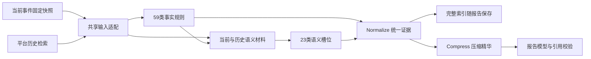

# 统一证据与上下文精华

事实算法输出指标和核验状态，语义任务输出解释和引用。统一层把异构结果整理为可追溯的证据实例，再按预算选出完整条目，供报告模型使用。

“59＋23”是证据类型数量，一个规则可能在多个范围产生多个实例，没有执行结果的类型也保留不可用状态。归一不会修改算法结论，不把缺失或跳过变成否定结果。

## 统一字段

`normalization.go` 的 `UnifiedEvidence` 包含：

| 字段 | 含义 |
| --- | --- |
| id / report_id | 稳定统一编号和报告E编号 |
| kind / rule_id / task_id / subject_id | 类型及执行身份 |
| scope / window / snapshot_version | 资产、端点、时间、快照版本 |
| status / execution_status / quality | 结果、执行状态、材料质量分别保存 |
| role | 测量事实、阴性结果、解释、背景、重复项、缺口 |
| measurements / parameters | 原算法实际指标和判定参数 |
| interpretation / judgement / strength | 已校验的解释与解释强度 |
| source_ids / dependencies / version | 实际来源和依赖版本 |
| non_additive_with / duplicate_of | 同一依据不重复计证 |
| reason / limitations | 原因与适用范围 |

完整 `normalized_evidence.items` 跟随不可变报告保存。页面可查看统一索引、原事实清单、语义清单和历史活动清单；查看及导出已有报告不会重新查询历史。

## 压缩

`compression.go` 的 `Compress` 只读统一索引，不查询数据库、不调用模型。报告适配器提供展示格式和阴性结果的相关性过滤。

优先历史正向规则和有效历史解释，再选择其他正向事实、实际观测、情报、其他解释和相关阴性结果。重复解释与材料缺口不选入正文正向证据。默认最多12项，条目序列化总量最多6000个Unicode字符。整条舍取，不截断JSON、不删除条目中的实际指标。

压缩同时保留总实例数、执行状态数量、缺口原因汇总、E/N编号和省略数量。完整来源保留在索引中，模型条目展示前3个定位引用和来源总数。最终提示仍执行整体预算检查，超预算辅助材料按完整字段移除。

报告模型收到 `selected_evidence`（统一后的精华）和 `evidence_digest`（全量概况），不收到59＋23项完整原始输出。事实、语义摘要不再重复作为两份大JSON发送。

“缺口”“阴性结果”“正文省略”含义不同；语义解释和依赖事实不是两份独立证据。概率仍是引用证据后的模型研判估计，统一层不杜撰概率公式。

## 验证边界

测试覆盖82类目录、范围身份、缺失与阴性区别、重复解释、状态统计、完整条目预算、历史实际进入规则与R06/R07、提示和DOCX来源保留。真实模型效果和生产数据库查询计划还需要实际事件验收。
